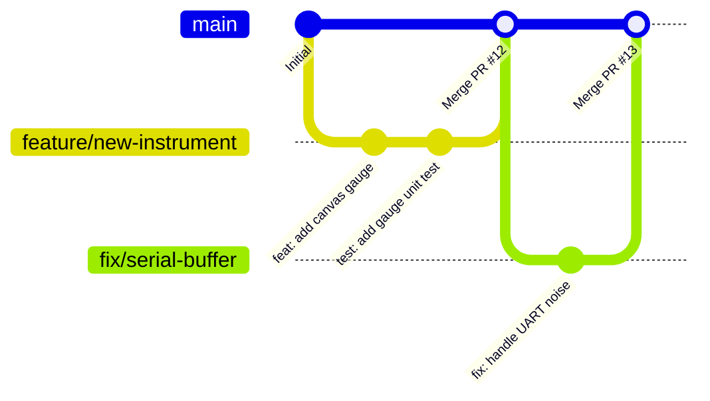

# Contributing to Rocket Telemetry Ground Station

> **Language / Idioma:** [ 🇬🇧 English ](CONTRIBUTING.md) | [ 🇪🇸 Español ](CONTRIBUTING.es.md)

Welcome to the **Rocket Telemetry Ground Station** (`estacion-terrena-pc`) development team!

This project is built to monitor experimental and sounding rocket avionics in real time. This guide outlines everything you need to know to get up and running, understand the system architecture, write quality code and tests, follow our Git workflow, and contribute effectively.

---

## Table of Contents

1. [Onboarding Walkthrough (Fast Track)](#1-onboarding-walkthrough-fast-track)
2. [Project Architecture & Repository Structure](#2-project-architecture--repository-structure)
3. [Git Workflow & Branch Strategy](#3-git-workflow--branch-strategy)
4. [Language & Documentation Standards](#4-language--documentation-standards)
5. [Code Style & Engineering Conventions](#5-code-style--engineering-conventions)
6. [Testing & Quality Assurance](#6-testing--quality-assurance)
7. [Simulators & Hardware-Free Development](#7-simulators--hardware-free-development)
8. [Pull Request (PR) & Review Process](#8-pull-request-pr--review-process)
9. [Release & Packaging Guidelines](#9-release--packaging-guidelines)

---

## 1. Onboarding Walkthrough (Fast Track)

Follow these steps to set up a fully functioning local environment from scratch in under 5 minutes.

### 1.1 Prerequisites
- **Python:** Version 3.10 or higher (Python 3.11+ recommended).
- **Operating System:** Linux (Debian, Ubuntu, Raspberry Pi OS), Windows 10/11, or macOS.
- **Git:** Standard CLI git client.
- **Web Browser:** Any modern evergreen browser (Chrome, Firefox, Edge, Safari).

### 1.2 Step 1: Clone and Set Up Virtual Environment

```bash
# Clone the repository
git clone https://github.com/your-org/estacion-terrena-pc.git
cd estacion-terrena-pc

# Create an isolated virtual environment
python3 -m venv .venv

# Activate the virtual environment
source .venv/bin/activate       # On Linux / macOS
# .venv\Scripts\activate        # On Windows (PowerShell / Command Prompt)

# Upgrade pip and install runtime dependencies
pip install --upgrade pip
pip install -r requirements.txt
```

> **Important:** Always make sure your virtual environment is activated before running scripts. `main.py` performs a startup check and will fail gracefully with guidance if dependencies are missing from the active Python interpreter.

### 1.3 Step 2: Configure Serial Permissions (Linux Only)

On Linux systems, direct hardware serial port access requires membership in the `dialout` group:

```bash
sudo usermod -aG dialout $USER
newgrp dialout
```

### 1.4 Step 3: Run the Automated Test Suite

Before modifying any code, verify that your local environment passes all existing automated tests:

```bash
python tests/test_telemetry_65b.py
# or using standard unittest discovery:
python -m unittest discover tests
```

You should see 8/8 tests passing with 100% pass rate.

### 1.5 Step 4: Launch the Ground Station

```bash
python main.py
```

Open your browser to:
- **`http://localhost:8000`** $\to$ Real-time mission dashboard
- **`http://localhost:8000/gonogo`** $\to$ Pre-flight Go / No-Go qualification view
- **`http://localhost:8000/api/status`** $\to$ System and serial health JSON endpoint

If no serial hardware is connected yet, the server will safely enter reconnect mode, retrying the configured port every 3 seconds while keeping the web and WebSocket server fully responsive.

---

## 2. Project Architecture & Repository Structure

The codebase is organized cleanly into functional areas:

```text
estacion-terrena-pc/
├── main.py                  # Core backend: FastAPI, serial_asyncio, parser, dual persistence
├── config/
│   ├── app.yaml             # Serial port, baudrate, network host/port, storage paths
│   └── frame.yaml           # Declarative binary telemetry schema and CRC-16 parameters
├── docs/                    # Authoritative technical documentation
│   ├── architecture.md      # End-to-end data pipeline and concurrency model
│   ├── protocol.md          # 65-byte LoRa frame layout, ToA budget, C++ avionics code
│   ├── frame-schema.md      # Declarative YAML frame schema specification
│   ├── frontend-dashboard.md# UI visual hierarchy, instrument specifications, wireframes
│   ├── api.md               # REST endpoints and WebSocket message schemas
│   ├── getting-started.md   # Deployment, operation, and troubleshooting manual
│   ├── packaging-exe.md     # PyInstaller Windows standalone compilation
│   └── calculos-futuros.md  # Kalman filter, variometer, landing ellipse algorithms
├── frontend/
│   ├── index.html           # High-contrast live mission dashboard
│   ├── gonogo.html          # Pre-launch Go / No-Go qualification console
│   ├── css/style.css        # Responsive dashboard layout and solar-readable styling
│   └── assets/              # SVG logos, mission badges, and icons
├── tests/
│   ├── __init__.py          # Test suite package marker
│   └── test_telemetry_65b.py# Automated verification (parser, CRC, sliding window, DB)
├── arduino/
│   └── telemetry_simulator/ # Microcontroller firmware simulating 290s flight profile
├── data/                    # Generated flight data (SQLite & CSV, git-ignored)
├── build_windows.bat        # 1-click Windows executable builder
├── ground_station.spec      # PyInstaller frozen bundle specification
├── .github/workflows/       # GitHub Actions CI/CD workflows
├── CONTRIBUTING.md          # Team contribution, onboarding, and PR guidelines
├── README.md                # Project overview and navigation hub
└── requirements.txt         # Production Python dependencies
```

### Key Architectural Rule: Zero Code Changes for Schema Changes
The Ground Station is **declarative**. The binary format of the incoming frame is defined in `config/frame.yaml`. Adding a sensor, modifying byte offsets, or changing numerical scaling factors is accomplished by modifying YAML, without touching `main.py`.

---

## 3. Git Workflow & Branch Strategy

We use a lightweight feature-branch workflow based on GitHub Pull Requests.



### 3.1 Branch Naming Conventions
Always create descriptive branch names prefixed by their category:
- `feature/<name>` — New feature or instrument (e.g. `feature/variometer-tape`)
- `fix/<name>` — Bug fix (e.g. `fix/sliding-window-overflow`)
- `docs/<name>` — Documentation updates (e.g. `docs/update-antenna-calc`)
- `test/<name>` — Adding or improving tests (e.g. `test/corrupt-sync-packets`)
- `refactor/<name>` — Internal restructuring with no functional change

### 3.2 Commit Message Standard (Conventional Commits)
All commit messages must be written in **English** and follow the [Conventional Commits](https://www.conventionalcommits.org/) specification:

```text
<type>(<optional scope>): <short description in present tense>

[optional body explaining WHY the change was made]

[optional footer(s) referencing issue numbers]
```

**Allowed Types:**
- `feat`: A new user-facing feature or backend capability
- `fix`: A bug fix
- `docs`: Documentation changes only
- `test`: Adding missing tests or correcting existing tests
- `refactor`: A code change that neither fixes a bug nor adds a feature
- `perf`: A code change that improves performance
- `chore`: Maintenance tasks, dependencies, or build config

**Examples:**
```text
feat(parser): add support for signed 24-bit integer fields
fix(buffer): prevent double-decrement when encountering adjacent sync bytes
docs(protocol): update RF link budget table with SF7 250kHz figures
test(storage): verify SQLite commit transaction on graceful shutdown
```

---

## 4. Language & Documentation Standards

- **English Immersion Directive:** All code, comments, docstrings, variable names, commit messages, PR descriptions, and technical documentation must be written strictly in **English**.
- If working with team members who communicate in Spanish, ensure all artifacts, code comments, and documentation remain in professional technical English.
- Keep markdown documents formatted cleanly with GitHub-flavored markdown, including clickable relative links (e.g. `[System Architecture](docs/architecture.md)`).
- Cross-reference related files whenever adding a new feature or documentation guide.

---

## 5. Code Style & Engineering Conventions

### 5.1 Python Standards
- **Target Version:** Python 3.11+ (compatible down to 3.10).
- **Style Guide:** Follow [PEP 8](https://peps.python.org/pep-0008/).
- **Type Annotations:** Use Python 3.10+ standard type hints (e.g. `dict[str, Any]`, `list[int]`, `Optional[float]`).
- **Resource Management:** Always use context managers (`with` statements) for files, database connections, and locks.
- **Asynchronous Execution:** Avoid blocking calls (`time.sleep()`, synchronous network/file I/O) inside async functions. Use `asyncio.sleep()` or execute heavy synchronous work in executors.
- **Safe Parsing:** Never assume incoming binary data is well-formed. Validate buffer boundaries, handle struct unpack errors gracefully, and reject corrupt frames early.

### 5.2 Frontend & UI Standards
- **Vanilla Simplicity:** The frontend uses zero heavy JavaScript frameworks (no React, Vue, or Webpack bundle step). It is delivered as pure HTML5, CSS3, and modern ECMAScript.
- **Sunlight Readability:** The dashboard is engineered for high-contrast field operations. Use the standardized color variables defined in `frontend/css/style.css`:
  - Nominal: Green (`#087a3b` / `#00e676`)
  - Warning: Amber (`#f2b400` / `#ffd600`)
  - Critical: Red (`#b00020` / `#ff1744`)
  - Informational: Blue (`#1a4fd6` / `#2979ff`)
- **Render Loop Decoupling:** Never trigger direct DOM mutations inside high-frequency WebSocket message handlers. Store the latest sample in client state and redraw Canvas instruments inside `requestAnimationFrame()`.
- **Memory Safety:** Prune client-side sliding window arrays (e.g. altitude charts, sequence trackers) to prevent memory leaks during multi-hour rocket operations.

---

## 6. Testing & Quality Assurance

Quality assurance is critical for aerospace and rocket monitoring software.

### 6.1 Running Tests
Always run the automated test suite from the repository root:

```bash
# Direct runner with detailed diagnostics:
python tests/test_telemetry_65b.py

# Standard unittest test runner:
python -m unittest discover tests
```

### 6.2 Test Coverage Scope
The existing test suite (`tests/test_telemetry_65b.py`) verifies:
1. **Frame Configuration Loading:** Confirms schema parsing from `config/frame.yaml` (length, offsets, CRC parameters, endianness).
2. **Definitive 65-Byte Packet Parsing:** Validates IEEE-754 floating-point decoding, integer conversion, linear scaling, and state enumerations across all 20 fields.
3. **CRC-16/CCITT-FALSE Integrity Check:** Proves that corrupted checksums are strictly rejected.
4. **Sliding Window Buffer Resynchronization:** Simulates noisy channels, garbage preamble bytes, false sync headers, and multi-packet chunks to guarantee no legitimate frames are dropped.
5. **Dual Persistence Engine:** Verifies simultaneous insertion into SQLite and CSV storage.
6. **Streaming Fragment Reassembly:** Simulates UART chunk fragmentation by streaming 5 bytes at a time and verifying exact reassembly.
7. **Consecutive False Sync Sequences:** Stresses the buffer with consecutive false sync bytes (`0xAA 0xAA 0xAA`) and verifies rapid recovery.
8. **Packet Statistics & Loss Tracking:** Validates rolling sequence tracking, packet skip detection, and real-time loss percentage calculation.

### 6.3 Rules for Writing Tests
- **Never weaken tests to pass:** Never skip, delete, or relax assertions in existing tests.
- **Test edge cases explicitly:** When adding new capabilities, write tests covering boundary conditions, zero inputs, corrupted bytes, and disconnection scenarios.
- **Self-contained tests:** Tests must use temporary directories (`tempfile.TemporaryDirectory()`) and clean up any mock resources automatically.

---

## 7. Simulators & Hardware-Free Development

You do not need physical rocket hardware to develop or test the ground station.

### 7.1 Virtual Serial Port Simulation (Linux)
You can create a pair of connected virtual serial ports using `socat`:

```bash
socat -d -d pty,raw,echo=0 pty,raw,echo=0
```
This produces two endpoints (e.g. `/dev/pts/2` and `/dev/pts/3`). Configure one in `config/app.yaml`, and run `mock_feeder.py` (documented in [`docs/getting-started.md`](docs/getting-started.md#61-hardware-free-testing-virtual-serial-loopback-with-socat)) on the other to pump telemetry into the station.

### 7.2 Microcontroller Simulator (Arduino / ESP32)
For high-fidelity hardware-in-the-loop simulation, we provide complete microcontroller firmware in [`arduino/telemetry_simulator/`](arduino/telemetry_simulator/):
- Simulates an authentic **290-second mission profile** (Standby pad sway $\to$ 9.8g Powered Ascent $\to$ Ballistic Burnout $\to$ Apogee $\to$ Drogue Chute $\to$ Main Parachute $\to$ Touchdown).
- Simulates real flight alerts: extreme lateral accelerations ($> 9.5\text{ g}$), packet loss bursts ($> 15\%$), and CRC corruption faults.
- Can be flashed onto Arduino Uno, Nano, Mega, ESP32, STM32, or Raspberry Pi Pico using the Arduino IDE or `arduino-cli`.
- See [`arduino/telemetry_simulator/README.md`](arduino/telemetry_simulator/README.md) for complete instructions.

---

## 8. Pull Request (PR) & Review Process

### 8.1 Preparing Your PR
1. **Branch from main:** Ensure your branch is rebased on the latest `origin/main`.
2. **Run tests:** Confirm `python tests/test_telemetry_65b.py` passes 100%.
3. **Check formatting & clean up:** Ensure no temporary debug logs, `.pyc` files, or test artifacts are committed.
4. **Update documentation:** If your change modifies configuration keys, APIs, or protocols, update the corresponding markdown files in `docs/`.

### 8.2 PR Description Template
When opening a Pull Request, include the following structure:

```markdown
## Summary
Brief description of the changes introduced by this PR.

## Motivation & Context
Why is this change required? What issue does it solve?

## Changes Made
- Added ...
- Fixed ...
- Updated ...

## Verification & Testing
- [x] Ran automated test suite (`python tests/test_telemetry_65b.py`) - 100% pass rate.
- [x] Tested live dashboard in browser with simulator / mock feeder.
- [x] Verified documentation cross-links and paths.

## Screenshots / Evidence (if applicable)
[Attach screenshots of UI changes or terminal outputs]
```

### 8.3 Review Guidelines
- Every PR requires review and approval from at least one core maintainer before merging.
- Automated CI workflows must pass.
- Squash-and-merge is preferred to maintain a clean linear commit history on `main`.

---

## 9. Release & Packaging Guidelines

### Windows Standalone Executable
The repository provides automated PyInstaller packaging for Windows:
- **Local Build:** Run `build_windows.bat` on any Windows computer with Python installed.
- **GitHub Actions Build:** The workflow `.github/workflows/build-exe.yml` automatically triggers on push to `main` and creates a downloadable release ZIP artifact (`dist/estacion-terrena-windows.zip`).
- For complete details, see [`docs/packaging-exe.md`](docs/packaging-exe.md).

---

Thank you for contributing to the **Rocket Telemetry Ground Station**! If you have questions or encounter issues, open an Issue on GitHub or reach out to the avionics software lead.
