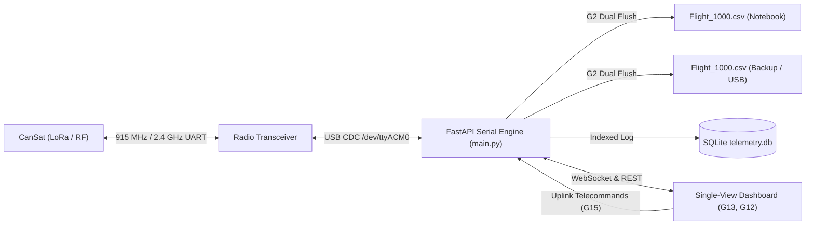

# CanSat CONAE Ground Station (2026–2027)

A robust, real-time telemetry acquisition, processing, and telecommand ground station built for the **CONAE CanSat 2026–2027 Competition** in full compliance with **Bases §4–§7** and the **Technical Requirements Annex (G1–G15, X1–X6, C1–C9, E1–E7, S1–S8)**.

---

## Technical Compliance Summary

| Req. ID | Specification | Implementation in Ground Station | Status |
| :--- | :--- | :--- | :--- |
| **G13** | **Single GUI (No Tabs)** | All telemetry, 5 graphs, map, terminal, and controls visible simultaneously without tabs or page switching. | **COMPLIANT** |
| **G12** | **Daylight Readability** | High-contrast sunlight theme (dark text `#000000` on `#ffffff`/`#f1f5f9`), font size $\ge 14\,\text{pt}$ (18.66 px), bold axes (`lineWidth: 2`), and bold traces (`lineWidth: 3`). | **COMPLIANT** |
| **G5** | **Live Text Telemetry** | Streaming ASCII terminal at the bottom displaying raw comma-separated lines at 1 Hz during ascent and descent. | **COMPLIANT** |
| **G6** | **SI Units** | Every displayed metric and graph axis explicitly indicates its SI unit (`m`, `°C`, `kPa`, `V`, `A`, `m/s²`, `°/s`, `m/s`, `sats`). | **COMPLIANT** |
| **G7** | **5 Real-Time Graphs** | Real-time plotting for: (1) Altitude, (2) Battery Voltage, (3) Battery Current, (4) 3-Axis Accelerometer, (5) 3-Axis Gyroscope. | **COMPLIANT** |
| **G8** | **Mission Telemetry** | Real-time displays for Mission Time UTC (`hh:mm:ss`), Temperature, GPS position, RX packets, Lost packets, and Flight State. | **COMPLIANT** |
| **G14** | **RX Packet Counter** | Ground station maintains an independent `RX_COUNT` tracking successfully received and validated frames. | **COMPLIANT** |
| **G15 / G1** | **Telecommand Uplink** | Interactive telecommand console supporting zero-altitude calibration (`CMD,1000,CAL`), UTC time sync (`CMD,1000,ST`), packet reset, battery query, sim mode, and custom uplink. | **COMPLIANT** |
| **G2** | **Dual CSV Persistence** | Instantaneous flushed recording to `data/Flight_1000.csv` (PC) and `data/backup/Flight_1000.csv` (Backup storage / USB). | **COMPLIANT** |
| **C3 / C4** | **Descent Velocity** | Computes vertical descent velocity ($V_z = \Delta h / \Delta t$) in real time to verify compliance with C3 ($15 \pm 3\,\text{m/s}$) and C4 ($5 \pm 3\,\text{m/s}$). | **COMPLIANT** |
| **X1 / X2** | **RF Regulations** | 915–928 MHz / 2.4 GHz band compliance, point-to-point addressing (P2P with `TEAM_ID` prefix, no broadcast). | **COMPLIANT** |

---

## Official Telemetry Protocol (CONAE Plain-Text CSV)

The station processes 1 Hz telemetry matching the official comma-separated layout:

```text
TEAM_ID, MISSION_TIME, PACKET_COUNT, MODE, STATE, ALTITUDE, TEMPERATURE, PRESSURE, VOLTAGE, CURRENT, GYRO_R, GYRO_P, GYRO_Y, ACCEL_R, ACCEL_P, ACCEL_Y, GPS_TIME, GPS_ALTITUDE, GPS_LATITUDE, GPS_LONGITUDE, GPS_SATS, CMD_ECHO [,,OPTIONAL_DATA]
```

### Fields Specification

1. **`TEAM_ID`**: 4-digit team identification number (e.g. `'1000'`).
2. **`MISSION_TIME`**: UTC time formatted as `hh:mm:ss` (1 second resolution).
3. **`PACKET_COUNT`**: Persistent counter of transmitted packets since power-on.
4. **`MODE`**: `'F'` for Flight mode, `'S'` for Simulation mode.
5. **`STATE`**: Operational flight software state: `'LAUNCH_PAD'`, `'ASCENT'`, `'APOGEE'`, `'DESCENT'`, `'PROBE_RELEASE'`, `'PAYLOAD_RELEASE'`, `'LANDED'`.
6. **`ALTITUDE`**: Barometric altitude in meters relative to launchpad ground level ($0.1\,\text{m}$ resolution).
7. **`TEMPERATURE`**: Ambient sensor temperature in degrees Celsius ($0.1\,^\circ\text{C}$ resolution).
8. **`PRESSURE`**: Sensor atmospheric pressure in $\text{kPa}$ ($0.1\,\text{kPa}$ resolution).
9. **`VOLTAGE`**: Power bus voltage in Volts ($0.1\,\text{V}$ resolution).
10. **`CURRENT`**: Battery current draw in Amperes ($0.01\,\text{A}$ resolution).
11. **`GYRO_R`, `GYRO_P`, `GYRO_Y`**: Gyroscope roll, pitch, and yaw rotation rates in degrees per second ($^\circ\text{/s}$).
12. **`ACCEL_R`, `ACCEL_P`, `ACCEL_Y`**: Accelerometer roll, pitch, and yaw readings in $\text{m/s}^2$ ($g$).
13. **`GPS_TIME`**: GPS receiver UTC time in `hh:mm:ss` ($1\,\text{s}$ resolution).
14. **`GPS_ALTITUDE`**: GPS altitude in meters above mean sea level ($0.1\,\text{m}$ resolution).
15. **`GPS_LATITUDE`**: GPS latitude in decimal degrees ($0.0001^\circ$ resolution).
16. **`GPS_LONGITUDE`**: GPS longitude in decimal degrees ($0.0001^\circ$ resolution).
17. **`GPS_SATS`**: Number of tracked GPS satellites (integer).
18. **`CMD_ECHO`**: Text of the last telecommand received and processed by CanSat (e.g. `CAL`, `ST120000`, `CXON`).
19. **`OPTIONAL_DATA`**: Optional payload sensors appended after double commas (`,,`).

---

## System Architecture



---

## Quick Start Guide

### 1. Requirements

- Python 3.10+ (Python 3.11 recommended)
- Linux / Raspberry Pi OS / Windows 10/11 / macOS
- Serial Transceiver (USB CDC ACM, CP2102, FTDI, LoRa modem, SiK radio)

### 2. Virtual Environment Setup

```bash
# Create and activate virtual environment
python3 -m venv .venv
source .venv/bin/activate       # On Linux / macOS
# .venv\Scripts\activate        # On Windows

# Install dependencies
pip install -r requirements.txt
```

### 3. Run Automated Verification Tests

```bash
python -m unittest discover tests
```

*Runs both CanSat plain-text telemetry verification and legacy 65-byte frame test suites (14 tests, 100% pass rate).*

### 4. Running the Ground Station

```bash
# Start the Ground Station server (default port 8080)
.venv/bin/python main.py
```

Open your browser and navigate to:
**`http://localhost:8080`**

### 5. Running the Microcontroller & PTY Simulator

If no physical radio hardware is plugged in, launch the built-in virtual UART simulator:

```bash
python3 scripts/cansat_simulator.py
```

*Creates `/tmp/cansat_uart` and streams a realistic 1 Hz CanSat flight trajectory (Launchpad $\to$ Ascent $\to$ Apogee separation $\to$ C3 15 m/s descent $\to$ C4 5 m/s descent $\to$ Touchdown) while responding to all telecommands.*

---

## Telecommand Uplink Protocol (G15, G1, F3, F5, X6, X3)

Commands are transmitted over serial as ASCII strings terminated by `\r\n`:

| Command String | Description | Requirements |
| :--- | :--- | :--- |
| `CMD,1000,CAL` | Calibrate relative altitude to $0.0\,\text{m}$ on launchpad | **G1, F5** |
| `CMD,1000,ST,13:14:02` | Synchronize CanSat onboard RTC with UTC time ($\pm 1\,\text{s}$) | **F3, F2** |
| `CMD,1000,PC,0` | Reset persistent transmitted packet counter to zero | **F1** |
| `CMD,1000,BATT` | Request battery voltage, current, and solar panel status | **X6, G7** |
| `CMD,1000,SIM,ENABLE` | Enable simulation mode (`MODE='S'`) | Bases §4 |
| `CMD,1000,START` | Signal rocket separation / mission start trigger | **X3** |

---

## Preliminary Design Review (PDR) Report
The complete engineering trade-off report, link budget calculations, antenna comparisons, Argentine pricing/availability, and resolution of specification ambiguities (TBR/TBD) are documented in:
* **[docs/pdr_tradeoff_report.md](file:///home/x7reme13/estacion-terrena-cansat/docs/pdr_tradeoff_report.md)**

---

## Radio Link & Hardware Trade-Off Analysis (PDR Summary)

### 1. Frequency Band & Modulation
- **Band (X1):** 915–928 MHz (ENACOM authorized license-free ISM band in Argentina). Offers superior propagation and penetration through rocket airframes compared to 2.4 GHz.
- **Transceiver Alternatives:**
  - **Semtech SX1262 (LoRa):** Recommended. High sensitivity ($-124\,\text{dBm}$ @ SF7), programmable $+22\,\text{dBm}$ output, time-on-air $98.5\,\text{ms}$ at SF7 / BW 250 kHz, low RX current ($15\,\text{mA}$). Readily available in Argentina (Ebyte E22-900T22D).
  - **HopeRF RFM95W / SX1276:** Secondary choice ($-120\,\text{dBm}$, $+20\,\text{dBm}$).
  - **SiK 915 MHz Telemetry Radio:** Full UART bridge, easy plug-and-play, but higher idle power consumption ($50\,\text{mA}$).

### 2. Antennas (CanSat & Ground Station)
- **CanSat Antenna (Action 2):** Encapsulated helical or rigid quarter-wave monopole tuned to 915 MHz ($8.05\,\text{cm}$ length). Mounted internally on the central avionics sled to allow unobstructed sliding from the rocket canister (S7) and survive 30G landing shock (S5).
- **Ground Station Antenna (Action 3):** 915 MHz vertical collinear antenna ($+5.0\,\text{dBi}$) on portable tabletop tripod (G11). Provides $360^\circ$ hemispherical coverage without manual tracking, yielding a fade margin $> 46\,\text{dB}$ at $2.5\,\text{km}$.

### 3. Energy & Autonomy (G9, G10, E7)
- **Station Battery Autonomy:** Ground station laptop runs on internal battery ($\ge 2\,\text{h}$, G9). Radio transceiver is powered via USB port ($5\,\text{V}$, $<35\,\text{mA}$ RX / $120\,\text{mA}$ TX, $<0.36\,\text{Wh}$ over 2 hours, drawing $<0.7\%$ of laptop battery).
- **CanSat Power:** Panasonic NCR18650B Li-ion cell ($3.7\,\text{V}$, $3400\,\text{mAh}$) in metallic casing (E1, E2) with fixed soldered/bolted tabs (M4, no spring contacts). Total flight draw $\approx 89\,\text{mA}$, providing $\approx 38\,\text{hours}$ of autonomy ($\gg 2\,\text{hours}$ required by E7).

---

## File Structure

```text
estacion-terrena-cansat/
├── config/
│   ├── app.yaml               # Ground station, port, storage, and mission limit configurations
│   ├── frame.yaml             # Official 22-field CanSat ASCII CSV telemetry schema
│   └── frame_65b.yaml         # Legacy 65-byte binary frame schema (test suite compatibility)
├── data/
│   ├── Flight_1000.csv        # Primary flushed telemetry log for judges (G2)
│   ├── backup/
│   │   └── Flight_1000.csv    # Simultaneous backup telemetry log (G2)
│   └── telemetry.db           # SQLite indexed telemetry database
├── docs/                      # Technical documentation suite
│   ├── pdr_tradeoff_report.md # Comprehensive PDR engineering report (Trade-offs & TBR/TBD)
│   ├── protocol.md            # Official telemetry & telecommand protocol specification
│   ├── architecture.md        # Asynchronous pipeline & zero-scroll architecture
│   └── ...
├── frontend/
│   ├── index.html             # Zero-scroll single-window daylight dashboard (G13, G12, G7, G8)
│   ├── css/common.css         # High-contrast CSS styling
│   └── js/common.js           # Frontend data and packet tracker utilities
├── arduino/
│   └── telemetry_simulator/   # Microcontroller 1 Hz CanSat firmware & command parser
├── scripts/
│   ├── cansat_simulator.py    # Virtual UART PTY CanSat trajectory & command simulator
│   └── audit_viewport.py      # Automated headless Chromium layout and viewport auditor
├── tests/
│   ├── test_cansat_telemetry.py # Unit test suite for CanSat CSV, loss tracking, and dual CSV
│   └── test_telemetry_65b.py    # Binary frame parser test suite
├── main.py                    # Core FastAPI backend, serial engine, dual CSV & telecommands
└── requirements.txt           # Python project dependencies
```
