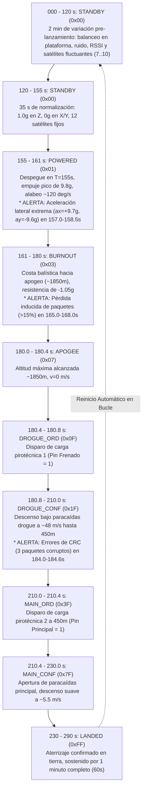

# Simulador de Telemetría de Cohetes (Firmware Arduino / ESP32)

> **Idioma / Language:** [ 🇪🇸 Español ](README.es.md) | [ 🇬🇧 English ](README.md)

Este firmware se ejecuta en cualquier microcontrolador (Arduino Uno R3, Nano, Mega, ESP32, Teensy, RP2040) y simula un **perfil completo de vuelo de 290 segundos** transmitiendo la **trama definitiva de telemetría LoRa de 65 bytes** a **10 Hz (intervalo de 100 ms)** y **115200 baudios**, diseñado para probar cada instrumento, gráfico, mapa, insignia de alerta y transición de estados en el Tablero de la Estación Terrena (`estacion-terrena-pc`).

---

## 1. Inicio Rápido

### 1.1 Grabación mediante `arduino-cli`
```bash
# Para Arduino Uno:
arduino-cli compile -b arduino:avr:uno -u -p /dev/ttyACM0 arduino/telemetry_simulator

# Para ESP32:
arduino-cli compile -b esp32:esp32:esp32 -u -p /dev/ttyUSB0 arduino/telemetry_simulator
```

### 1.2 Ejecución con la Estación Terrena
1. Asegúrese de que el puerto `/dev/ttyACM0` o `/dev/ttyUSB0` esté configurado en [`config/app.yaml`](../../config/app.yaml).
2. Inicie la estación terrena:
   ```bash
   python main.py
   ```
3. Abra su navegador en **`http://localhost:8000`**.

---

## 2. Cronología y Perfil de Vuelo Simulado (290 Segundos)



---

## 3. Alertas en Vuelo Evaluadas

| Alerta | Intervalo de Misión | Comportamiento Simulado | Respuesta del Tablero |
|---|---|---|---|
| **Aceleración cercana al límite** (ALERTA) | $157.0\text{ s}$ a $158.5\text{ s}$ | $a_x = +9.7\text{ g}$, $a_y = -9.6\text{ g}$ ($|a| \ge 9.5\text{ g}$) | Activa insignia amarilla `ALERTA` y amplía la escala del gráfico de aceleración. |
| **Pérdida de paquetes** (CRÍTICO) | $165.0\text{ s}$ a $168.0\text{ s}$ | Saltos en la numeración que elevan la pérdida a $> 15\%$ | Activa insignia roja `CRÍTICO` y resalta en rojo la métrica de pérdida. |
| **Tramas con error de CRC** (INFO) | $184.0\text{ s}$ a $184.6\text{ s}$ | Corrompe la suma CRC en 3 tramas (`crc ^= 0xAAAA`) | Incrementa el contador de inválidos y muestra insignia azul `INFO` (`3`). |
| **Pirotecnia: Pin Frenado** (INFO/WARN) | $180.4\text{ s}$ en adelante | El valor lógico de Pin Frenado conmuta de 0 a 1 | Cambia la insignia a `ACTIVADO` y registra el hito de vuelo. |
| **Pirotecnia: Pin Principal** (INFO/WARN) | $210.0\text{ s}$ en adelante | El valor lógico de Pin Principal conmuta de 0 a 1 | Cambia la insignia a `ACTIVADO` y registra el hito de vuelo. |

---

## 4. Disposición de la Trama de 65 Bytes

- Offset 0: `sync` (`uint8`, fijo `0xAA`)
- Offset 1–2: `frame_number` (`uint16 LE`, 2 bytes)
- Offset 3–6: `timestamp` (`uint32 LE`, 4 bytes, ms)
- Offset 7: `status` (`uint8`, 1 byte)
- Offset 8–11: `pressure` (`float32 LE`, 4 bytes, hPa)
- Offset 12–15: `altura_actual` (`float32 LE`, 4 bytes, m barométrica)
- Offset 16–19: `accel_x` (`float32 LE`, 4 bytes, g)
- Offset 20–23: `accel_y` (`float32 LE`, 4 bytes, g)
- Offset 24–27: `accel_z` (`float32 LE`, 4 bytes, g)
- Offset 28–31: `gyro_x` (`float32 LE`, 4 bytes, deg/s)
- Offset 32–35: `gyro_y` (`float32 LE`, 4 bytes, deg/s)
- Offset 36–39: `gyro_z` (`float32 LE`, 4 bytes, deg/s)
- Offset 40–43: `temp_imu` (`float32 LE`, 4 bytes, °C)
- Offset 44–47: `latitude` (`float32 LE`, 4 bytes, grados dec.)
- Offset 48–51: `longitude` (`float32 LE`, 4 bytes, grados dec.)
- Offset 52–55: `altitud_gps` (`float32 LE`, 4 bytes, m sobre nivel del mar)
- Offset 56: `satellites` (`uint8`, 1 byte)
- Offset 57–60: `ground_speed` (`float32 LE`, 4 bytes, m/s)
- Offset 61: `pin_frenado` (`uint8`, 1 byte, 0/1)
- Offset 62: `pin_principal` (`uint8`, 1 byte, 0/1)
- Offset 63–64: `crc` (`uint16 LE`, 2 bytes, CRC-16/CCITT-FALSE sobre bytes 0..62)
