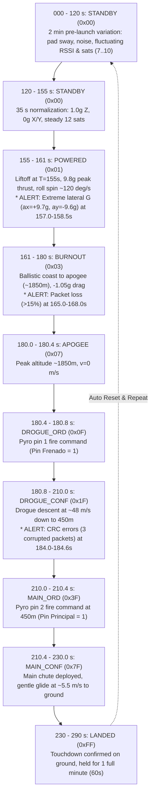

# Rocket Telemetry Simulator (Arduino / ESP32 Firmware)

> **Language / Idioma:** [ 🇬🇧 English ](README.md) | [ 🇪🇸 Español ](README.es.md)

This firmware runs on any Arduino, ESP32, or microcontroller (Arduino Uno R3, Nano, Mega, ESP32, Teensy, RP2040) and simulates a **comprehensive 290-second mission profile** transmitting the **definitive 65-byte LoRa telemetry frame** at **10 Hz (100 ms interval)** and **115200 baud**, designed to test every instrument, chart, map, alert badge, and state machine transition in the Ground Station Dashboard (`estacion-terrena-pc`).

---

## 1. Quick Start

### 1.1 Flashing via arduino-cli
```bash
# For Arduino Uno
arduino-cli compile -b arduino:avr:uno -u -p /dev/ttyACM0 arduino/telemetry_simulator

# Or for ESP32
arduino-cli compile -b esp32:esp32:esp32 -u -p /dev/ttyUSB0 arduino/telemetry_simulator
```

### 1.2 Running with Ground Station
1. Ensure the port `/dev/ttyACM0` or `/dev/ttyUSB0` is configured in [`config/app.yaml`](../../config/app.yaml).
2. Start the Ground Station:
   ```bash
   python main.py
   ```
3. Open your browser to **`http://localhost:8000`**.

---

## 2. 290-Second Mission Profile & Simulated Timeline



---

## 3. In-Flight Alerts Tested

| Alert | Timing | Simulated Behavior | Dashboard Response |
|---|---|---|---|
| **Aceleración cercana al límite** (ALERTA) | $157.0\text{ s}$ to $158.5\text{ s}$ | $a_x = +9.7\text{ g}$, $a_y = -9.6\text{ g}$ ($|a| \ge 9.5\text{ g}$) | Triggers yellow `ALERTA` badge and expands acceleration chart scale. |
| **Pérdida moderada / alta de paquetes** (CRÍTICO) | $165.0\text{ s}$ to $168.0\text{ s}$ | Sequence skips and dropped packets driving 5-second loss $> 15\%$ | Triggers red `CRÍTICO` badge and turns packet loss metric red. |
| **Tramas con error de CRC** (INFO) | $184.0\text{ s}$ to $184.6\text{ s}$ | Corrupts CRC checksum on 3 packets (`crc ^= 0xAAAA`) | Increments invalid frames counter and triggers blue `INFO` alert badge (`3`). |
| **Pirotecnia: Pin Frenado** (INFO/WARN) | $180.4\text{ s}$ onwards | Pin Frenado logic switches from 0 to 1 | Turns badge to `ACTIVADO` and registers flight milestone event. |
| **Pirotecnia: Pin Principal** (INFO/WARN) | $210.0\text{ s}$ onwards | Pin Principal logic switches from 0 to 1 | Turns badge to `ACTIVADO` and registers flight milestone event. |

---

## 4. 65-Byte Binary Frame Layout

- Offset 0: `sync` (`uint8`, fixed `0xAA`)
- Offset 1–2: `frame_number` (`uint16 LE`, 2 bytes)
- Offset 3–6: `timestamp` (`uint32 LE`, 4 bytes, ms)
- Offset 7: `status` (`uint8`, 1 byte)
- Offset 8–11: `pressure` (`float32 LE`, 4 bytes, hPa)
- Offset 12–15: `altura_actual` (`float32 LE`, 4 bytes, m barométrica)
- Offset 16–19: `accel_x` (`float32 LE`, 4 bytes, g)
- Offset 20–23: `accel_y` (`float32 LE`, 4 bytes, g)
- Offset 24–27: `accel_z` (`float32 LE`, 4 bytes, g)
- Offset 28–31: `gyro_x` (`float32 LE`, 4 bytes, deg/s)
- Offset 32–35: `gyro_y` (`float32 LE`, 4 bytes, deg/s)
- Offset 36–39: `gyro_z` (`float32 LE`, 4 bytes, deg/s)
- Offset 40–43: `temp_imu` (`float32 LE`, 4 bytes, °C)
- Offset 44–47: `latitude` (`float32 LE`, 4 bytes, deg)
- Offset 48–51: `longitude` (`float32 LE`, 4 bytes, deg)
- Offset 52–55: `altitud_gps` (`float32 LE`, 4 bytes, m ASL)
- Offset 56: `satellites` (`uint8`, 1 byte)
- Offset 57–60: `ground_speed` (`float32 LE`, 4 bytes, m/s)
- Offset 61: `pin_frenado` (`uint8`, 1 byte, 0/1)
- Offset 62: `pin_principal` (`uint8`, 1 byte, 0/1)
- Offset 63–64: `crc` (`uint16 LE`, 2 bytes, CRC-16/CCITT-FALSE over bytes 0..62)
