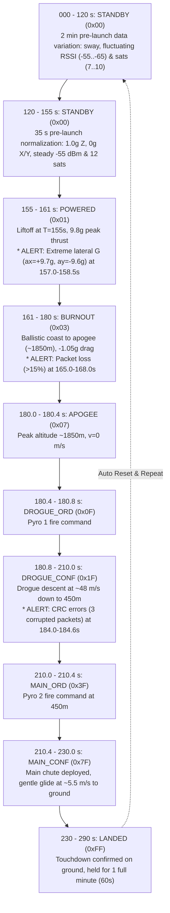

# Rocket Telemetry Simulator (Arduino Firmware)

This firmware runs on any Arduino or microcontroller (Arduino Uno R3, Nano, Mega, ESP32, Teensy, RP2040) and simulates a **comprehensive 290-second mission profile** transmitted at **5 Hz (200 ms interval)** and **115200 baud**, designed to test every instrument, chart, map, alert badge, and state machine transition in the Ground Station Dashboard (`estacion-terrena-pc`).

---

## 1. Quick Start

### 1.1 Flashing via arduino-cli
```bash
arduino-cli compile -b arduino:avr:uno -u -p /dev/ttyACM0 arduino/telemetry_simulator
```

### 1.2 Running with Ground Station
1. Ensure the port `/dev/ttyACM0` is configured in [`config/app.yaml`](../../config/app.yaml).
2. Start the Ground Station:
   ```bash
   python main.py
   ```
3. Open your browser to **`http://localhost:8000`**.

---

## 2. 290-Second Mission Profile & Simulated Timeline



---

## 3. In-Flight Alerts Tested

| Alert | Timing | Simulated Behavior | Dashboard Response |
|---|---|---|---|
| **Aceleración cercana al límite** (ALERTA) | $157.0\text{ s}$ to $158.5\text{ s}$ | $a_x = +9.7\text{ g}$, $a_y = -9.6\text{ g}$ ($|a| \ge 9.5\text{ g}$) | Triggers yellow `ALERTA` badge and expands acceleration chart scale. |
| **Pérdida moderada / alta de paquetes** (CRÍTICO) | $165.0\text{ s}$ to $168.0\text{ s}$ | Sequence skips and dropped packets driving 5-second loss $> 15\%$ | Triggers red `CRÍTICO` badge and turns packet loss metric red. |
| **Tramas con error de CRC** (INFO) | $184.0\text{ s}$ to $184.6\text{ s}$ | Corrupts CRC checksum on 3 packets (`crc ^= 0xAAAA`) | Increments invalid frames counter and triggers blue `INFO` alert badge (`3`). |

---

## 4. 29-Byte Binary Frame Layout

- Offset 0: `rocket_id` (`uint8`, 1 byte)
- Offset 1: `frame_type` (`uint8`, 1 byte, expected `0x01`)
- Offset 2–3: `frame_number` (`uint16 BE`, 2 bytes)
- Offset 4–7: `timestamp` (`uint32 BE`, 4 bytes, ms)
- Offset 8–9: `accel_x` (`int16 BE`, 2 bytes, scale 0.001)
- Offset 10–11: `accel_y` (`int16 BE`, 2 bytes, scale 0.001)
- Offset 12–13: `accel_z` (`int16 BE`, 2 bytes, scale 0.0005)
- Offset 14–17: `latitude` (`int32 BE`, 4 bytes, scale 0.000001)
- Offset 18–21: `longitude` (`int32 BE`, 4 bytes, scale 0.000001)
- Offset 22–23: `altitude` (`int16 BE`, 2 bytes, scale 1.0)
- Offset 24: `status` (`uint8`, 1 byte, cumulative bitmask)
- Offset 25: `rssi` (`int8`, 1 byte, signed dBm)
- Offset 26: `satellites` (`uint8`, 1 byte, GNSS satellites count)
- Offset 27–28: `crc` (`uint16 BE`, 2 bytes, CRC-16/CCITT-FALSE over bytes 0..26)
