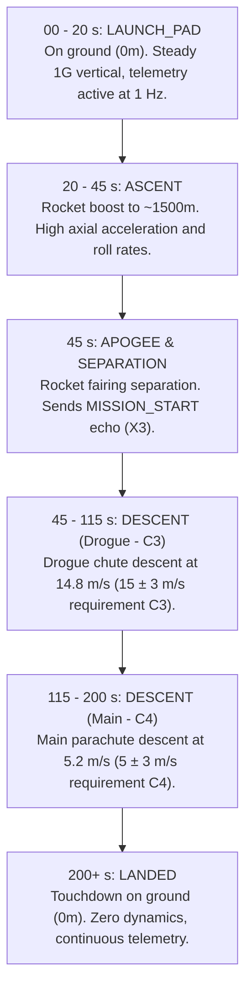

# CanSat Telemetry & Command Simulator (Arduino / ESP32 Firmware)

> **Language:** [ 🇬🇧 English ](README.md)

This firmware runs on any Arduino or ESP32-compatible microcontroller (Arduino Uno R3, Nano, Mega, ESP32, Teensy, RP2040) and simulates a complete **CONAE CanSat 2026–2027 flight profile**, transmitting the official **ASCII CSV telemetry stream** at **1 Hz (1 packet per second)** and **115200 baud**, while listening for and executing incoming **telecommands** from the Ground Station.

---

## 1. Quick Start

### 1.1 Flashing via arduino-cli
```bash
# For Arduino Uno
arduino-cli compile -b arduino:avr:uno -u -p /dev/ttyACM0 arduino/telemetry_simulator

# Or for ESP32
arduino-cli compile -b esp32:esp32:esp32 -u -p /dev/ttyUSB0 arduino/telemetry_simulator
```

### 1.2 Running with Ground Station
1. Connect the microcontroller via USB.
2. Ensure the serial port (e.g. `/dev/ttyACM0` or `/dev/ttyUSB0`) is configured in [`config/app.yaml`](../../config/app.yaml).
3. Start the Ground Station:
   ```bash
   .venv/bin/python main.py
   ```
4. Open your browser to **`http://localhost:8080`**.

---

## 2. Flight Trajectory & Mission Phases



---

## 3. Supported Telecommands (Ground Station $\to$ CanSat)

The firmware listens continuously on `Serial` and executes incoming telecommands matching the CONAE protocol (`CMD,<TEAM_ID>,<ACTION>[,<ARGS>]`):

| Telecommand | Action Executed by Firmware |
| :--- | :--- |
| `CMD,1000,CAL` | Sets `altitudeOffset = currentAltitude`, zeroing relative altitude (**G1**). Sets `CMD_ECHO='CAL'`. |
| `CMD,1000,ST,14:20:00` | Synchronizes onboard mission time to UTC time (**F3**). Sets `CMD_ECHO='ST'`. |
| `CMD,1000,PC,0` | Resets persistent transmitted packet counter to zero (**F1, F5**). |
| `CMD,1000,BATT` | Queries power bus and responds with battery status (**X6, G7**). |
| `CMD,1000,SIM,ENABLE` | Sets flight mode flag to simulation (`MODE='S'`) (**Bases §4**). |
| `CMD,1000,START` | Triggers manual ascent / separation state transition (**X3**). |

---

## 4. Telemetry Frame Layout (ASCII CSV at 1 Hz)

```text
TEAM_ID, MISSION_TIME, PACKET_COUNT, MODE, STATE, ALTITUDE, TEMPERATURE, PRESSURE, VOLTAGE, CURRENT, GYRO_R, GYRO_P, GYRO_Y, ACCEL_R, ACCEL_P, ACCEL_Y, GPS_TIME, GPS_ALTITUDE, GPS_LATITUDE, GPS_LONGITUDE, GPS_SATS, CMD_ECHO [,,OPTIONAL_DATA]
```
