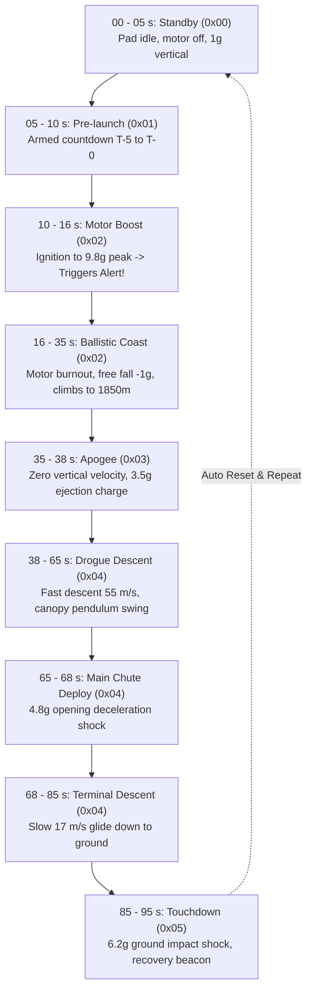

# Rocket Telemetry Simulator (Arduino Demo)

This sketch runs on any Arduino or microcontroller (Arduino Uno, Nano, Mega, ESP32, Teensy, RP2040, STM32) and generates a simulated **high-fidelity 95-second suborbital rocket mission** transmitted at **5 Hz (200 ms interval)** and **115200 baud**, designed to test every instrument, chart, map, state transition, and alert badge in the **Ground Station Dashboard** (`estacion-terrena-pc`).

---

## 1. Quick Start

### 1.1 Uploading via Arduino IDE
1. Open the Arduino IDE.
2. Open [`telemetry_simulator.ino`](telemetry_simulator.ino).
3. Select your microcontroller under **Tools > Board** (e.g., *Arduino Uno*, *ESP32 Dev Module*).
4. Select your serial port under **Tools > Port**.
5. Click **Upload** (Ctrl + U / Cmd + U).

### 1.2 Running with Ground Station
1. Close the Arduino IDE Serial Monitor (to free the serial device).
2. Configure [`config/app.yaml`](../../config/app.yaml):
   ```yaml
   serial:
     port: "/dev/ttyACM0"  # or /dev/ttyUSB0 (Windows: COM3, COM4, etc.)
     baudrate: 115200
     reconnect_delay: 3
   ```
3. Start the Ground Station:
   ```bash
   python main.py
   ```
4. Open your browser to **`http://localhost:8000`**.

---

## 2. Simulated Mission Phases (95-Second Profile)

The flight executes a continuous 95-second flight cycle that loops automatically:



### Mission Phase Breakdown & Dashboard Effects

| Time Range | State Code | State Label | Physical Phenomena Modeled | Dashboard Instruments Tested |
|:---|:---:|:---|:---|:---|
| **00 – 10 s** | `0x00` | `STANDBY` | Vehicle upright on launchpad; engine cold; resting $a_z = 1.0\text{ g}$. | Mission clock start, initial green GPS marker (`Inicio`), pad baseline on altitude tape. |
| **10 – 16 s** | `0x01` | `POWERED` | Liftoff at $T+10\text{s}$; ignition ramp up to **$9.8\text{ g}$** peak thrust at $T+10.8\text{s}$; acoustic vibrations ($X, Y$). | **Triggers ISA-18.2 Warning Badge:** `ACELERACIÓN CERCANA AL LÍMITE` ($\ge 9.5\text{ g}$); chart Y-axis auto-expansion. |
| **16 – 35 s** | `0x03` | `BURNOUT` | Motor burnout; free fall proper acceleration ($a_z = -1.0\text{ g}$); vehicle climbs from $450\text{ m}$ to $1850\text{ m}$; wind drift. | Altitude tape moves through hundreds of meters; Leaflet map begins drawing downwind track. |
| **35.0 – 35.3 s** | `0x07` | `APOGEE` | Vertical velocity crosses $0\text{ m/s}$ at peak altitude ($1850\text{ m}$). | Maximum altitude indicator (`MÁX: 1850 m`); chart event line labeled `APOGEE`. |
| **35.3 – 35.7 s** | `0x0F` | `DROGUE_ORD` | Black powder ejection charge command sent; $+3.5\text{ g}$ separation impulse. | Event log registers `DROGUE_ORD`; pyro firing recorded. |
| **35.7 – 65 s** | `0x1F` | `DROGUE_CONF` | Drogue parachute confirmed deployed; fast descent ($\sim 55\text{ m/s}$); pendulum sway. | Rapid tape descent; barometric pressure recovery; cyclic sway on acceleration chart. |
| **65.0 – 65.4 s** | `0x3F` | `MAIN_ORD` | Main parachute deployment command sent at $350\text{ m}$ altitude. | Event log registers `MAIN_ORD`. |
| **65.4 – 85 s** | `0x7F` | `MAIN_CONF` | Main parachute confirmed open; opening deceleration shock ($+4.8\text{ g}$ on $Z$); gentle glide ($\sim 17\text{ m/s}$). | Opening shock spike captured on chart; glide trajectory flattens toward ground. |
| **85 – 95 s** | `0xFF` | `LANDED` | Touchdown at $T+85.0\text{s}$; ground contact shock pulse ($+6.2\text{ g}$); vehicle motionless at $0\text{ m}$. | Event log records `LANDED`; recovery beacon coordinates locked on map. |

---

## 3. Stress Testing Configuration

You can enable or disable testing modes using the preprocessor defines at the top of [`telemetry_simulator.ino`](telemetry_simulator.ino):

```cpp
// 1: 30-Byte Ground Station frame (Default) | 0: 22-Byte legacy format
#define USE_GROUND_STATION_30BYTE_FRAME 1

// 1: Intentionally skip packets during high-G boost to test link health badges
// 0: 100% clean reception (Default)
#define SIMULATE_RF_PACKET_LOSS 0
```

When `SIMULATE_RF_PACKET_LOSS` is set to `1`:
- The simulator drops 1 out of every 5 packets during high-speed motor burn ($13\text{–}15.5\text{ s}$) and drogue descent ($50\text{–}54\text{ s}$).
- This exercises the dashboard's **5-second sliding window** calculation and triggers the amber/red link health badges:
  - `PÉRDIDA MODERADA (5s)` ($> 5\%$)
  - `ALTA PÉRDIDA DE PAQUETES (5s)` ($> 15\%$)

---

## 4. Related Documentation

- **[Frame Specification & Binary Protocol Reference](../../docs/protocol.md):** 30-byte frame memory map, field data types, scales, and CRC-16 specification.
- **[Getting Started & Operations Guide](../../docs/getting-started.md):** Hardware configuration, Linux serial permissions, runtime operation, and verification testing.
- **[System Architecture & Component Documentation](../../docs/architecture.md):** Data pipeline, async concurrency model, and frontend dashboard.
- **[Project Entry Point & Index](../../README.md):** Repository overview and documentation directory.

