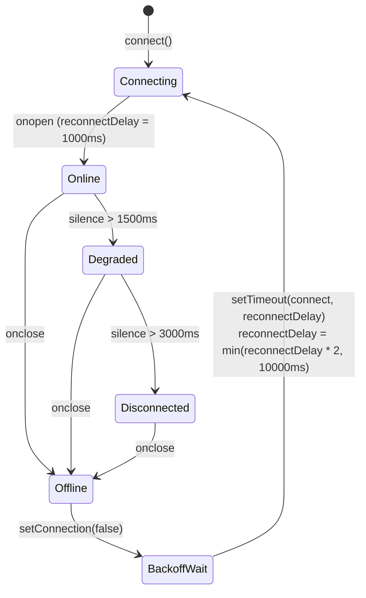

# API & WebSocket Interface Specification

> **Language / Idioma:** [ 🇬🇧 English ](api.md) | [ 🇪🇸 Español ](es/api.md)

This document defines the REST API endpoints and real-time WebSocket protocol exposed by the Ground Station backend (`main.py`).

---

## 1. Overview & Base URL

The Ground Station server runs on FastAPI and Uvicorn. By default, it binds to all network interfaces on port `8000`:

- **Base URL:** `http://localhost:8000` (or `http://<station-ip>:8000`)
- **WebSocket URL:** `ws://localhost:8000/ws/telemetry` (or `ws://localhost:8000/ws`)
- **Protocol Versions:** HTTP/1.1, WebSocket RFC 6455
- **Default Content Type:** `application/json`

---

## 2. REST API Endpoints

### 2.1 Web Dashboard Root
Returns the primary single-page telemetry dashboard.

- **Route:** `GET /`
- **Authentication:** None
- **Request Headers:** Standard HTTP headers
- **Response Type:** `text/html; charset=utf-8`

#### Success Response (`200 OK`)
Returns the complete `frontend/index.html` dashboard application.

#### Error Response (`200 OK` Fallback)
If the frontend asset is missing from disk:
```json
{
  "error": "Frontend no encontrado",
  "path": "/home/x7reme13/estacion-terrena-pc/frontend/index.html"
}
```

---

### 2.2 Pre-Flight Go / No-Go Checklist View
Serves the high-contrast Go/No-Go qualification dashboard.

- **Route:** `GET /gonogo`
- **Method:** `GET`
- **Authentication:** None
- **Response Type:** `text/html; charset=utf-8`

#### Success Response (`200 OK`)
Returns the complete `frontend/gonogo.html` operational view (or falls back to `index.html` if missing).

---

### 2.3 Post-Flight Recovery & Search View
Serves the search-and-rescue (SAR) tactical tracking and rocket retrieval console.

- **Route:** `GET /recovery`
- **Method:** `GET`
- **Authentication:** None
- **Response Type:** `text/html; charset=utf-8`

#### Success Response (`200 OK`)
Returns the complete `frontend/recovery.html` operational view (or falls back to `index.html` if missing).

---

### 2.4 System & Link Status
Returns the operational health of the ground station, serial port link status, Go/No-Go flight safety thresholds, and cumulative packet transmission statistics.

- **Route:** `GET /api/status`
- **Method:** `GET`
- **Authentication:** None
- **Query Parameters:** None

#### Response Schema

| Field | Type | Description |
|---|---|---|
| `connected` | `boolean` | `true` if serial UART link is open and active; `false` otherwise |
| `frames_received` | `integer` | Cumulative count of valid telemetry frames decoded since server start |
| `last_timestamp` | `float` \| `null` | Unix timestamp (seconds) of the most recent telemetry packet |
| `serial_port` | `string` \| `null` | Configured serial device path (e.g. `"/dev/ttyACM0"`) |
| `baudrate` | `integer` \| `null` | Configured UART baud rate (e.g. `115200`) |
| `statistics` | `object` | Rolling packet health metrics (see [Statistics Schema](#34-packet-statistics-schema)) |
| `gonogo` | `object` | Configured Go/No-Go stability requirements and sensor tolerances |

#### Example Response (`200 OK`)
```json
{
  "connected": true,
  "frames_received": 1450,
  "last_timestamp": 1718300042.8125,
  "serial_port": "/dev/ttyACM0",
  "baudrate": 115200,
  "statistics": {
    "received": 1450,
    "lost": 2,
    "invalid": 0,
    "loss_percent": 0.13774104683195593
  },
  "gonogo": {
    "required_hold_s": 30.0,
    "altitude_tol_m": 5.0,
    "accel_xy_tol_g": 0.1,
    "accel_z_nominal_g": 1.0,
    "accel_z_tol_g": 0.15,
    "gps_radius_m": 5.0,
    "weather_limits": {
      "max_wind_speed_ms": 10.0,
      "max_cloud_cover_pct": 75.0,
      "min_visibility_km": 5.0
    }
  }
}
```

#### Disconnected Initial State Response
```json
{
  "connected": false,
  "frames_received": 0,
  "last_timestamp": null,
  "serial_port": "/dev/ttyACM0",
  "baudrate": 115200,
  "statistics": {
    "received": 0,
    "lost": 0,
    "invalid": 0,
    "loss_percent": 0.0
  }
}
```

---

### 2.5 Latest Telemetry Snapshot
Retrieves the most recent decoded telemetry frame, raw hex representation, CRC verification status, and link statistics.

- **Route:** `GET /api/telemetry`
- **Method:** `GET`
- **Authentication:** None
- **Query Parameters:** None

#### Response Schema

| Field | Type | Description |
|---|---|---|
| `connected` | `boolean` | `true` if serial interface is active |
| `timestamp` | `float` \| `null` | Unix timestamp of the last decoded frame |
| `data` | `object` \| `null` | Decoded telemetry fields and labels (see [Telemetry Data Object](#251-telemetry-data-object)) |
| `frame_length` | `integer` | Configured frame size in bytes (e.g. `65` for definitive LoRa frame) |
| `crc_valid` | `boolean` | `true` if the last frame passed CRC-16 verification |
| `crc_value` | `string` \| `null` | Hexadecimal string of received CRC bytes (e.g. `"B1A4"`) |
| `raw_hex` | `string` \| `null` | Space-separated uppercase hexadecimal dump of the 65-byte raw frame |
| `statistics` | `object` | Cumulative packet statistics snapshot |

#### 2.5.1 Telemetry Data Object (`data`)

| Key | Type | Unit | Description |
|---|---|---|---|
| `sync` | `integer` | — | Synchronization byte (fixed `0xAA` / `170`) |
| `frame_number` | `integer` | — | Sequential frame sequence number (`0`–`65535`) |
| `timestamp` | `integer` | `ms` | Mission elapsed time / avionics boot time |
| `status` | `integer` | — | Flight state code (`0`–`255`) |
| `status_label` | `string` | — | Flight state label (`"STANDBY"`, `"POWERED"`, `"BURNOUT"`, `"APOGEE"`, `"DROGUE_CONF"`, `"MAIN_CONF"`, `"LANDED"`) |
| `pressure` | `float` | `hPa` | Atmospheric pressure |
| `altura_actual` | `float` | `m` | Geometric altitude |
| `accel_x` | `float` | `g` | X-axis body acceleration |
| `accel_y` | `float` | `g` | Y-axis body acceleration |
| `accel_z` | `float` | `g` | Z-axis body acceleration |
| `gyro_x` | `float` | `deg/s` | Roll rotational velocity |
| `gyro_y` | `float` | `deg/s` | Pitch rotational velocity |
| `gyro_z` | `float` | `deg/s` | Yaw rotational velocity |
| `temp_imu` | `float` | `°C` | IMU temperature sensor readout |
| `latitude` | `float` | `deg` | GPS latitude in decimal degrees |
| `longitude` | `float` | `deg` | GPS longitude in decimal degrees |
| `altitud_gps` | `float` | `m` | GPS geometric altitude |
| `satellites` | `integer` | — | Number of tracked GPS satellites |
| `ground_speed` | `float` | `m/s` | Horizontal ground speed |
| `pin_frenado` | `integer` | — | Drogue pyro channel pin state (`0` or `1`) |
| `pin_frenado_label` | `string` | — | Pyro state label (`"DESACTIVADO"` / `"ACTIVADO"`) |
| `pin_principal` | `integer` | — | Main chute pyro channel pin state (`0` or `1`) |
| `pin_principal_label` | `string` | — | Pyro state label (`"DESACTIVADO"` / `"ACTIVADO"`) |

#### Example Response (`200 OK`)
```json
{
  "connected": true,
  "timestamp": 1718300042.8125,
  "data": {
    "sync": 170,
    "frame_number": 105,
    "timestamp": 155400,
    "status": 1,
    "status_label": "POWERED",
    "pressure": 995.4,
    "altura_actual": 152.8,
    "accel_x": 0.15,
    "accel_y": -0.12,
    "accel_z": 4.85,
    "gyro_x": 1.25,
    "gyro_y": -0.85,
    "gyro_z": 45.0,
    "temp_imu": 31.5,
    "latitude": -34.6038,
    "longitude": -58.3817,
    "altitud_gps": 177.8,
    "satellites": 14,
    "ground_speed": 18.6,
    "pin_frenado": 0,
    "pin_frenado_label": "DESACTIVADO",
    "pin_principal": 0,
    "pin_principal_label": "DESACTIVADO"
  },
  "frame_length": 65,
  "crc_valid": true,
  "crc_value": "B1A4",
  "raw_hex": "AA 69 00 E8 5E 02 00 01 CD CC 78 44 66 66 18 43 9A 99 19 3E F6 28 F6 BD 66 66 9B 40 00 00 A0 3F 9A 99 59 BF 00 00 34 42 00 00 FC 41 F4 04 0A C2 ED 52 69 C2 66 66 31 43 0E CD CC 94 41 00 00 B1 A4",
  "statistics": {
    "received": 105,
    "lost": 0,
    "invalid": 0,
    "loss_percent": 0.0
  }
}
```

#### Disconnected Initial State Response (No Frames Received Yet)
```json
{
  "connected": false,
  "timestamp": null,
  "data": null,
  "frame_length": 65,
  "crc_valid": false,
  "crc_value": null,
  "raw_hex": null,
  "statistics": {
    "received": 0,
    "lost": 0,
    "invalid": 0,
    "loss_percent": 0.0
  }
}
```

---

### 2.6 Historical Telemetry Query
Retrieves recent historical frames within a sliding time window (default 60 seconds) up to a configurable sample limit.

- **Route:** `GET /api/history`
- **Method:** `GET`
- **Authentication:** None
- **Query Parameters:**
  - `seconds` (`float`, optional, default: `60.0`): Historical time window duration in seconds relative to current time.
  - `limit` (`integer`, optional, default: `1200`): Maximum number of historical records to return.

#### Response Schema
Returns a JSON array of parsed telemetry objects matching the structure in [Telemetry Data Object](#251-telemetry-data-object):
```json
[
  {
    "timestamp": 1718300041.8125,
    "data": {
      "frame_number": 104,
      "altura_actual": 120.4,
      "pressure": 998.2
    }
  },
  {
    "timestamp": 1718300042.8125,
    "data": {
      "frame_number": 105,
      "altura_actual": 124.8,
      "pressure": 997.8
    }
  }
]
```

---


## 3. WebSocket Streaming Interface

The ground station provides real-time bi-directional WebSocket streaming.

### 3.1 Endpoints
The server supports two interchangeable route aliases:
- `ws://<host>:<port>/ws/telemetry` (recommended primary endpoint)
- `ws://<host>:<port>/ws` (convenience alias)

### 3.2 Connection Lifecycle
1. **Handshake:** Client initiates standard HTTP upgrade request.
2. **Acceptance:** Server accepts the connection and registers the socket in `WebSocketManager`.
3. **Immediate Greeting:** Server immediately transmits a `connection` message indicating serial hardware state:
   ```json
   {
     "type": "connection",
     "connected": true
   }
   ```
4. **Immediate State Sync:** If `runtime.last_frame` is present, the server immediately pushes the last recorded `telemetry` message so new clients do not need to wait for the next incoming packet.
5. **Streaming Ingestion:**
   - Every valid decoded UART frame triggers a broadcast `telemetry` event.
   - CRC error increments trigger a broadcast `statistics` event.
   - Serial cable disconnects or reconnects trigger a broadcast `connection` event.
6. **Disconnection Handling:** If a client drops or closes, the server unregisters the connection cleanly without interrupting ongoing telemetry distribution to other clients.

---

### 3.3 Message Packet Formats

All messages transmitted over the WebSocket are UTF-8 encoded JSON objects containing a top-level `type` discriminator.

#### 1. Telemetry Message (`type: "telemetry"`)
Broadcast whenever a valid 65-byte frame is received and verified.

```json
{
  "type": "telemetry",
  "timestamp": 1718300042.8125,
  "frame_length": 65,
  "crc_valid": true,
  "crc_value": "B1A4",
  "raw_hex": "AA 69 00 E8 5E 02 00 01 CD CC 78 44 66 66 18 43 9A 99 19 3E F6 28 F6 BD 66 66 9B 40 00 00 A0 3F 9A 99 59 BF 00 00 34 42 00 00 FC 41 F4 04 0A C2 ED 52 69 C2 66 66 31 43 0E CD CC 94 41 00 00 B1 A4",
  "data": {
    "sync": 170,
    "frame_number": 105,
    "timestamp": 155400,
    "status": 1,
    "status_label": "POWERED",
    "pressure": 995.4,
    "altura_actual": 152.8,
    "accel_x": 0.15,
    "accel_y": -0.12,
    "accel_z": 4.85,
    "gyro_x": 1.25,
    "gyro_y": -0.85,
    "gyro_z": 45.0,
    "temp_imu": 31.5,
    "latitude": -34.6038,
    "longitude": -58.3817,
    "altitud_gps": 177.8,
    "satellites": 14,
    "ground_speed": 18.6,
    "pin_frenado": 0,
    "pin_frenado_label": "DESACTIVADO",
    "pin_principal": 0,
    "pin_principal_label": "DESACTIVADO"
  },
  "statistics": {
    "received": 105,
    "lost": 0,
    "invalid": 0,
    "loss_percent": 0.0,
    "frames_received": 105
  }
}
```

#### 2. Connection State Message (`type: "connection"`)
Broadcast upon initial socket connection, when the serial port is opened, or when the serial port is lost.

```json
{
  "type": "connection",
  "connected": true
}
```

#### 3. Statistics Update Message (`type: "statistics"`)
Broadcast when invalid frames (CRC or framing errors) are detected.

```json
{
  "type": "statistics",
  "statistics": {
    "received": 1450,
    "lost": 2,
    "invalid": 1,
    "loss_percent": 0.13774104683195593
  }
}
```

---

### 3.4 Packet Statistics Schema

The `statistics` object provides quantitative radio link health indicators:

| Property | Type | Description |
|---|---|---|
| `received` | `integer` | Total number of valid telemetry frames successfully decoded |
| `lost` | `integer` | Count of skipped frames detected via jumps in sequential `frame_number` |
| `invalid` | `integer` | Count of corrupted frames rejected due to invalid length, CRC mismatch, or unexpected `frame_type` |
| `loss_percent` | `float` | Cumulative percentage: $\frac{\text{lost}}{\text{received} + \text{lost}} \times 100$ |
| `frames_received` | `integer` | *(Optional, included in broadcast frames)* Mirror of runtime received frames counter |

---

### 3.5 Client Reconnection & Resiliency Strategy

The dashboard client (`frontend/index.html`) implements a resilient multi-tier reconnection model:



1. **Exponential Backoff:**
   - If the WebSocket closes unexpectedly (`onclose`), the client marks the link as disconnected.
   - Initial retry delay is `1,000 ms`.
   - On each subsequent failed attempt, the delay doubles (`reconnectDelay = Math.min(reconnectDelay * 2, 10000)`), capping at `10,000 ms` to avoid network storms.
   - Upon successful handshake (`onopen`), `reconnectDelay` resets immediately to `1,000 ms`.
2. **Dual-Path Health Polling:**
   - An independent timer (`setInterval(loadStatus, 5000)`) polls `GET /api/status` every 5 seconds.
   - If the WebSocket stream encounters silent proxy drops, the HTTP poll verifies server connectivity and refreshes global packet statistics.

---

## 4. Related Documentation

- **[System Architecture & Component Documentation](architecture.md):** Architectural design, FastAPI async concurrency model, and frontend render engine.
- **[Frame Specification & Binary Protocol Reference](protocol.md):** 65-byte LoRa frame memory map, field data types, scales, and CRC-16 specification.
- **[Frame Schema Specification](frame-schema.md):** Declarative YAML frame definition reference and active production schema.
- **[Dashboard Visual Specification](frontend-dashboard.md):** Telemetry dashboard UI layout, visual hierarchy, and instrument wireframes.
- **[Getting Started & Operations Guide](getting-started.md):** System configuration, Linux serial permissions, runtime operation, and verification testing.
- **[Windows Executable Packaging](packaging-exe.md):** Compiling standalone Windows .exe using PyInstaller or GitHub Actions.
- **[Extended Calculations & Future Reference](future-calculations.md):** Algorithmic extensions and mathematical derivations.
