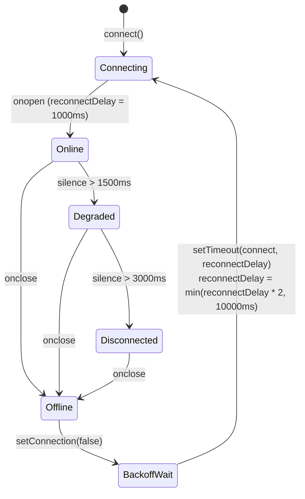

# API & WebSocket Interface Specification

This document defines the REST API endpoints and real-time WebSocket protocol exposed by the Ground Station backend (`main.py`).

---

## 1. Overview & Base URL

The Ground Station server runs on FastAPI and Uvicorn. By default, it binds to all network interfaces on port `8000`:

- **Base URL:** `http://localhost:8000` (or `http://<station-ip>:8000`)
- **WebSocket URL:** `ws://localhost:8000/ws/telemetry` (or `ws://localhost:8000/ws`)
- **Protocol Versions:** HTTP/1.1, WebSocket RFC 6455
- **Default Content Type:** `application/json`

---

## 2. REST API Endpoints

### 2.1 Web Dashboard Root
Returns the primary single-page telemetry dashboard.

- **Route:** `GET /`
- **Authentication:** None
- **Request Headers:** Standard HTTP headers
- **Response Type:** `text/html; charset=utf-8`

#### Success Response (`200 OK`)
Returns the complete `frontend/index.html` dashboard application.

#### Error Response (`200 OK` Fallback)
If the frontend asset is missing from disk:
```json
{
  "error": "Frontend no encontrado",
  "path": "/home/x7reme13/estacion-terrena-pc/frontend/index.html"
}
```

---

### 2.2 System & Link Status
Returns the operational health of the ground station, serial port link status, and cumulative packet transmission statistics.

- **Route:** `GET /api/status`
- **Method:** `GET`
- **Authentication:** None
- **Query Parameters:** None

#### Response Schema

| Field | Type | Description |
|---|---|---|
| `connected` | `boolean` | `true` if serial UART link is open and active; `false` otherwise |
| `frames_received` | `integer` | Cumulative count of valid telemetry frames decoded since server start |
| `last_timestamp` | `float` \| `null` | Unix timestamp (seconds) of the most recent telemetry packet |
| `serial_port` | `string` \| `null` | Configured serial device path (e.g. `"/dev/ttyACM0"`) |
| `baudrate` | `integer` \| `null` | Configured UART baud rate (e.g. `115200`) |
| `statistics` | `object` | Rolling packet health metrics (see [Statistics Schema](#34-packet-statistics-schema)) |

#### Example Response (`200 OK`)
```json
{
  "connected": true,
  "frames_received": 1450,
  "last_timestamp": 1718300042.8125,
  "serial_port": "/dev/ttyACM0",
  "baudrate": 115200,
  "statistics": {
    "received": 1450,
    "lost": 2,
    "invalid": 0,
    "loss_percent": 0.13774104683195593
  }
}
```

#### Disconnected Initial State Response
```json
{
  "connected": false,
  "frames_received": 0,
  "last_timestamp": null,
  "serial_port": "/dev/ttyACM0",
  "baudrate": 115200,
  "statistics": {
    "received": 0,
    "lost": 0,
    "invalid": 0,
    "loss_percent": 0.0
  }
}
```

---

### 2.3 Latest Telemetry Snapshot
Retrieves the most recent decoded telemetry frame, raw hex representation, CRC verification status, and link statistics.

- **Route:** `GET /api/telemetry`
- **Method:** `GET`
- **Authentication:** None
- **Query Parameters:** None

#### Response Schema

| Field | Type | Description |
|---|---|---|
| `connected` | `boolean` | `true` if serial interface is active |
| `timestamp` | `float` \| `null` | Unix timestamp of the last decoded frame |
| `data` | `object` \| `null` | Decoded telemetry fields and labels (see [Telemetry Data Object](#231-telemetry-data-object)) |
| `frame_length` | `integer` | Configured frame size in bytes (normally `30`) |
| `crc_valid` | `boolean` | `true` if the last frame passed CRC-16 verification |
| `crc_value` | `string` \| `null` | Hexadecimal string of received CRC bytes (e.g. `"9DE2"`) |
| `raw_hex` | `string` \| `null` | Space-separated uppercase hexadecimal dump of the 30-byte raw frame |
| `statistics` | `object` | Cumulative packet statistics snapshot |

#### 2.3.1 Telemetry Data Object (`data`)

| Key | Type | Unit | Description |
|---|---|---|---|
| `rocket_id` | `integer` | — | Rocket identifier (e.g. `1`) |
| `frame_type` | `integer` | — | Frame type identifier (`1`) |
| `frame_number` | `integer` | — | Sequential frame sequence number (`0`–`65535`) |
| `timestamp` | `integer` | `ms` | Mission elapsed time / avionics boot time |
| `accel_x` | `float` | `g` | X-axis acceleration ($1\text{ mg}$ resolution) |
| `accel_y` | `float` | `g` | Y-axis acceleration ($1\text{ mg}$ resolution) |
| `accel_z` | `float` | `g` | Z-axis acceleration ($0.5\text{ mg}$ resolution) |
| `pressure` | `integer` | `Pa` | Atmospheric pressure |
| `latitude` | `float` | `deg` | GNSS latitude ($10^{-6}$ degree resolution) |
| `longitude` | `float` | `deg` | GNSS longitude ($10^{-6}$ degree resolution) |
| `altitude` | `integer` | `m` | Geometric altitude |
| `status` | `integer` | — | Current flight state code (`0`–`5`) |
| `status_label` | `string` \| `null` | — | Human-readable phase label (e.g. `"Motor encendido / Ascenso"`) |

#### Example Response (`200 OK`)
```json
{
  "connected": true,
  "timestamp": 1718300042.8125,
  "data": {
    "rocket_id": 1,
    "frame_type": 1,
    "frame_number": 1450,
    "timestamp": 145000,
    "accel_x": 0.082,
    "accel_y": -0.015,
    "accel_z": 3.4215,
    "pressure": 98450,
    "latitude": -34.603722,
    "longitude": -58.381592,
    "altitude": 248,
    "status": 2,
    "status_label": "Motor encendido / Ascenso"
  },
  "frame_length": 30,
  "crc_valid": true,
  "crc_value": "9DE2",
  "raw_hex": "01 01 05 AA 00 02 36 68 00 52 FF F1 1A BB 01 80 92 FD EF FD 36 FC 85 2A E8 00 F8 02 9D E2",
  "statistics": {
    "received": 1450,
    "lost": 2,
    "invalid": 0,
    "loss_percent": 0.13774104683195593
  }
}
```

#### Disconnected Initial State Response (No Frames Received Yet)
```json
{
  "connected": false,
  "timestamp": null,
  "data": null,
  "frame_length": 30,
  "crc_valid": false,
  "crc_value": null,
  "raw_hex": null,
  "statistics": {
    "received": 0,
    "lost": 0,
    "invalid": 0,
    "loss_percent": 0.0
  }
}
```

---


## 3. WebSocket Streaming Interface

The ground station provides real-time bi-directional WebSocket streaming.

### 3.1 Endpoints
The server supports two interchangeable route aliases:
- `ws://<host>:<port>/ws/telemetry` (recommended primary endpoint)
- `ws://<host>:<port>/ws` (convenience alias)

### 3.2 Connection Lifecycle
1. **Handshake:** Client initiates standard HTTP upgrade request.
2. **Acceptance:** Server accepts the connection and registers the socket in `WebSocketManager`.
3. **Immediate Greeting:** Server immediately transmits a `connection` message indicating serial hardware state:
   ```json
   {
     "type": "connection",
     "connected": true
   }
   ```
4. **Immediate State Sync:** If `runtime.last_frame` is present, the server immediately pushes the last recorded `telemetry` message so new clients do not need to wait for the next incoming packet.
5. **Streaming Ingestion:**
   - Every valid decoded UART frame triggers a broadcast `telemetry` event.
   - CRC error increments trigger a broadcast `statistics` event.
   - Serial cable disconnects or reconnects trigger a broadcast `connection` event.
6. **Disconnection Handling:** If a client drops or closes, the server unregisters the connection cleanly without interrupting ongoing telemetry distribution to other clients.

---

### 3.3 Message Packet Formats

All messages transmitted over the WebSocket are UTF-8 encoded JSON objects containing a top-level `type` discriminator.

#### 1. Telemetry Message (`type: "telemetry"`)
Broadcast whenever a valid 30-byte frame is received and verified.

```json
{
  "type": "telemetry",
  "timestamp": 1718300042.8125,
  "frame_length": 30,
  "crc_valid": true,
  "crc_value": "9DE2",
  "raw_hex": "01 01 05 AA 00 02 36 68 00 52 FF F1 1A BB 01 80 92 FD EF FD 36 FC 85 2A E8 00 F8 02 9D E2",
  "data": {
    "rocket_id": 1,
    "frame_type": 1,
    "frame_number": 1450,
    "timestamp": 145000,
    "accel_x": 0.082,
    "accel_y": -0.015,
    "accel_z": 3.4215,
    "pressure": 98450,
    "latitude": -34.603722,
    "longitude": -58.381592,
    "altitude": 248,
    "status": 2,
    "status_label": "Motor encendido / Ascenso"
  },
  "statistics": {
    "received": 1450,
    "lost": 2,
    "invalid": 0,
    "loss_percent": 0.13774104683195593,
    "frames_received": 1450
  }
}
```

#### 2. Connection State Message (`type: "connection"`)
Broadcast upon initial socket connection, when the serial port is opened, or when the serial port is lost.

```json
{
  "type": "connection",
  "connected": true
}
```

#### 3. Statistics Update Message (`type: "statistics"`)
Broadcast when invalid frames (CRC or framing errors) are detected.

```json
{
  "type": "statistics",
  "statistics": {
    "received": 1450,
    "lost": 2,
    "invalid": 1,
    "loss_percent": 0.13774104683195593
  }
}
```

---

### 3.4 Packet Statistics Schema

The `statistics` object provides quantitative radio link health indicators:

| Property | Type | Description |
|---|---|---|
| `received` | `integer` | Total number of valid telemetry frames successfully decoded |
| `lost` | `integer` | Count of skipped frames detected via jumps in sequential `frame_number` |
| `invalid` | `integer` | Count of corrupted frames rejected due to invalid length, CRC mismatch, or unexpected `frame_type` |
| `loss_percent` | `float` | Cumulative percentage: $\frac{\text{lost}}{\text{received} + \text{lost}} \times 100$ |
| `frames_received` | `integer` | *(Optional, included in broadcast frames)* Mirror of runtime received frames counter |

---

### 3.5 Client Reconnection & Resiliency Strategy

The dashboard client (`frontend/index.html`) implements a resilient multi-tier reconnection model:



1. **Exponential Backoff:**
   - If the WebSocket closes unexpectedly (`onclose`), the client marks the link as disconnected.
   - Initial retry delay is `1,000 ms`.
   - On each subsequent failed attempt, the delay doubles (`reconnectDelay = Math.min(reconnectDelay * 2, 10000)`), capping at `10,000 ms` to avoid network storms.
   - Upon successful handshake (`onopen`), `reconnectDelay` resets immediately to `1,000 ms`.
2. **Dual-Path Health Polling:**
   - An independent timer (`setInterval(loadStatus, 5000)`) polls `GET /api/status` every 5 seconds.
   - If the WebSocket stream encounters silent proxy drops, the HTTP poll verifies server connectivity and refreshes global packet statistics.

---

## 4. Related Documentation

- **[System Architecture & Component Documentation](architecture.md):** Architectural design, FastAPI async concurrency model, and frontend render engine.
- **[Frame Specification & Binary Protocol Reference](protocol.md):** 30-byte frame memory map, field data types, scales, and CRC-16 specification.
- **[Getting Started & Operations Guide](getting-started.md):** System configuration, Linux serial permissions, runtime operation, and verification testing.
- **[Extended Calculations & Future Reference](calculos-futuros.md):** Algorithmic extensions and mathematical derivations.
