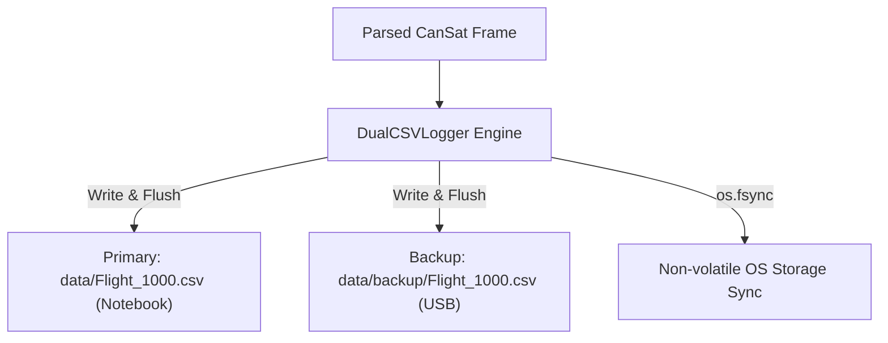

# System Architecture & Component Documentation

This document describes the end-to-end software and hardware architecture, asynchronous pipeline, persistence layers, and frontend rendering engine of the **CanSat CONAE Ground Station**.

---

## 1. System Overview

The CanSat Ground Station is an asynchronous, event-driven platform built using **Python 3.11+**, **FastAPI**, **`pyserial-asyncio`**, and a zero-dependency HTML5 Canvas rendering dashboard.

```mermaid
graph TD
    subgraph Hardware / Physical Layer
        CS[CanSat Flight Avionics] <-->|915 MHz RF Link| GSTR[Ground Station Transceiver]
        GSTR <-->|USB UART /dev/ttyACM0| OS[Serial Driver]
    end

    subgraph Backend Core (main.py)
        OS <-->|pyserial-asyncio| SP[CanSatSerialProtocol]
        SP --> AP[CanSatAsciiParser 1 Hz Engine]
        AP --> PROC[process_telemetry Pipeline]
        
        PROC --> DB[(SQLite Database telemetry.db)]
        PROC --> DUAL_CSV[(Dual CSV Logger: Flight_1000.csv)]
        DUAL_CSV --> D1[Primary Drive data/]
        DUAL_CSV --> D2[Backup Drive data/backup/]
        PROC --> STAT[PacketStatistics G14/G8]
        PROC --> WSM[WebSocketManager Hub]
        
        CMD_EP[POST /api/command] -->|Uplink Telecommand| SP
    end

    subgraph Presentation Layer (Single GUI - No Tabs, Zero Scroll)
        WSM <-->|WebSocket ws://localhost:8080/ws| WS_CLIENT[Client WebSocket Handler]
        WS_CLIENT --> C1[1. Altitud Barométrica Canvas]
        WS_CLIENT --> C2[2. Tensión Batería Canvas]
        WS_CLIENT --> C3[3. Corriente Batería Canvas]
        WS_CLIENT --> C4[4. Aceleraciones 3 Ejes Canvas]
        WS_CLIENT --> C5[5. Tasas de Rotación Canvas]
        WS_CLIENT --> MAP[Leaflet GPS Tracker]
        WS_CLIENT --> TERM[ASCII Text Stream Terminal G5]
        WS_CLIENT --> CMD_PANEL[Telecommand Panel G15/G1]
    end
```

---

## 2. Asynchronous Ingestion & Concurrency Model

### Serial Acquisition (`CanSatSerialProtocol`)
Operates within the `asyncio` event loop without blocking execution:
* Chunks received from the UART buffer are split on newline (`\r\n` or `\n`).
* Each extracted line is parsed into a strongly-typed `CanSatTelemetry` dataclass.
* Telecommand uplink messages are encoded directly into the active transport buffer.

### Telecommand Uplink (`POST /api/command`)
Operators dispatch commands directly from the dashboard:
1. Operator triggers action button (e.g., `CALIBRAR ALT (0m)`).
2. The browser sends a REST POST request or WebSocket command message.
3. The server formats the packet: `CMD,1000,CAL\r\n`.
4. The serial transport transmits the bytes over the radio channel.
5. The command is logged in the SQLite audit table and broadcast to all connected dashboard clients.

---

## 3. Dual Persistence Architecture (Requirement G2)

CONAE requirement **G2** mandates that all sensor telemetry be stored on the ground station computer and simultaneously on backup media (e.g., external USB flash drive):



* **Filename Format:** `Flight_XXXX.csv` where `XXXX` is `TEAM_ID`.
* **Zero Buffer Stalling:** Both files are flushed (`flush()`) and synced (`os.fsync`) on every frame so that immediate USB handover to the competition judges after landing has 100% data integrity with zero loss.

---

## 4. Single-Window Daylight Dashboard (Requirements G13, G12)

The presentation layer is designed strictly for intense solar environments:

1. **G13 Compliance (Single GUI, No Tabs):**
   * Layout is built as a unified 3-column CSS Grid.
   * All 5 charts, gauges, map, command console, and raw ASCII terminal are visible simultaneously.
   * Tab-based navigation is eliminated to prevent operator distraction during critical flight phases.

2. **G12 Compliance (Sunlight Readability):**
   * **Typography:** Minimum font size of $14\,\text{pt}$ ($18.66\,\text{px}$) for all metrics and values.
   * **Theme:** High-contrast daylight theme (dark `#000000` text on `#ffffff` / `#f1f5f9` backgrounds).
   * **Chart Rendering:** Canvas axes drawn with thick 2.0 px black lines and traces rendered with bold 3.0 px strokes.

3. **Zero Scroll Engine:**
   * Container is bounded by `100vh` and `100vw` with `overflow: hidden`.
   * Canvas dimensions dynamically track DOM element bounding boxes via `getBoundingClientRect()`.
