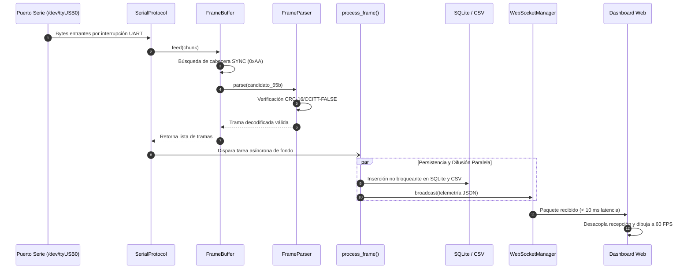

# Arquitectura del Sistema y Documentación de Componentes

> **Idioma / Language:** [ 🇪🇸 Español ](architecture.md) | [ 🇬🇧 English ](../architecture.md)

---

## 1. Visión General del Sistema

La Estación Terrena de Telemetría es una plataforma de adquisición asíncrona, validación cripto-aritmética, persistencia concurrente y visualización en tiempo real para cohetería experimental y de sondeo.

Recibe flujos binarios de telemetría desde la computadora de vuelo a través de un transceptor de radio conectado al puerto serie (UART/USB), decodifica y verifica las tramas dinámicamente frente a esquemas declarativos en YAML, persiste los datos en SQLite y CSV en paralelo, y difunde las métricas a un tablero web de baja latencia mediante WebSockets.

```mermaid
graph TD
    subgraph Capa Física / Hardware
        AV["Aviónica del Cohete (SX1278)"] -->|Enlace LoRa| GSTR["Receptor Terreno (Modem LoRa)"]
        GSTR -->|USB Serie /dev/ttyUSB0| OS["Controlador del SO (Linux/Win)"]
    end

    subgraph Núcleo Backend (main.py)
        OS -->|pyserial-asyncio| SP["SerialProtocol (asyncio.Protocol)"]
        SP --> FB["FrameBuffer (Acumulador y Ventana Deslizante)"]
        CFG[("config/frame.yaml")] -.-> FP["FrameParser (Motor de Decodificación)"]
        FB --> FP
        FP -->|Diccionario Decodificado| PF["Pipeline process_frame()"]
        
        PF --> DB[("Base de Datos SQLite (telemetry.db)")]
        PF --> CSV[("Registro CSV Plano (telemetry.csv)")]
        PF --> STAT["PacketStatistics (Contador y Pérdidas)"]
        PF --> WSM["WebSocketManager (Difusor Asíncrono)"]
    end

    subgraph Capa de Presentación (frontend/index.html)
        WSM -->|WebSocket ws://localhost:8000/ws| WS_CLIENT["Cliente WebSocket"]
        WS_CLIENT --> STATE["Estado y Buffers en Memoria"]
        STATE --> RAF["Motor de Render (requestAnimationFrame)"]
        RAF --> TAPE["Cinta de Altitud Canvas (Aeroespacial)"]
        RAF --> CHARTS["Osciloscopios Temporales Canvas"]
        RAF --> MAP["Mapa GPS Leaflet con Trayectoria WGS-84"]
        RAF --> ALERTS["Panel de Alarmas de Misión (ISA-18.2)"]
        RAF --> NUMS["Instrumentos Numéricos de Alto Contraste"]
    end
```

---

## 2. Pipeline de Datos End-to-End

El flujo de ingestión está diseñado para desacoplar completamente la adquisición de alta frecuencia respecto a la persistencia en disco y el renderizado en pantalla:



---

## 3. Modelo de Concurrencia Asíncrona (`asyncio`)

El servidor ejecuta un bucle de eventos único que no se bloquea ante operaciones de E/S lenta:

1. **Bucle de Reconexión Serie (`serial_loop`):**
   - Intenta establecer la conexión con el puerto serie configurado (`COMx` en Windows o `/dev/ttyUSBx` en Linux).
   - En caso de desconexión física accidental (cable suelto, reinicio del receptor), no arroja un crash: captura la excepción, notifica a los clientes vía WebSocket (`connected: false`), espera el tiempo `reconnect_delay` y reintenta automáticamente.

2. **Ventana Deslizante con Tolerancia al Ruido (`FrameBuffer`):**
   - Cuando el canal RF sufre ruidos o paquetes partidos entre lecturas del búfer UART, el acumulador preserva los fragmentos de cola para ensamblar tramas que llegan en lecturas sucesivas.
   - Si detecta un falso byte de sincronización que luego no valida por CRC, desliza el búfer byte a byte para reencontrar la trama legítima sin perder paquetes válidos subsiguientes.

3. **Doble Persistencia Inmediata:**
   - **SQLite (`telemetry.db`):** Almacenamiento relacional indexado por marca de tiempo (`timestamp`), ideal para hidratar rápidamente clientes que abren el navegador a mitad de la misión (`GET /api/history`).
   - **CSV (`telemetry.csv`):** Archivo plano en formato texto append-only con vaciado inmediato a disco (`file.flush()`), asegurando que ningún dato se pierda en caso de corte intempestivo de energía en la estación terrena.

4. **Renderizado Desacoplado y Suite de Vistas Operativas:**
   - La recepción por WebSocket coloca las muestras en un búfer circular en memoria compartida.
   - El renderizado gráfico ocurre a la frecuencia nativa del monitor ($60\text{ Hz}$) mediante `requestAnimationFrame`, evitando que ráfagas de paquetes saturen el motor de pintado del navegador.
   - La estación provee tres consolas especializadas:
     - **Tablero de Telemetría en Tiempo Real (`/` $\to$ `frontend/index.html`):** Monitoreo en vuelo con cinta altimétrica, osciloscopios, mapa GIS y alarmas ISA-18.2.
     - **Consola Pre-Vuelo Go / No-Go (`/gonogo` $\to$ `frontend/gonogo.html`):** Verificación de baselines y temporizador de estabilidad acumulativa.
     - **Consola de Búsqueda y Recuperación (`/recovery` $\to$ `frontend/recovery.html`):** Navegación táctica post-impacto con brújula de rumbo, distancia geodésica, soporte para dispositivos móviles y enlace directo a Google Maps.

---

## 4. Documentación Relacionada

- **[Especificación del Protocolo Binario](protocol.md):** Estructura en memoria de la trama de 65 bytes.
- **[Esquema Declarativo de Trama (YAML)](frame-schema.md):** Reglas de configuración en `config/frame.yaml`.
- **[Especificación de la API y WebSocket](api.md):** Formato de mensajes y endpoints de integración.
- **[Diseño del Dashboard Frontend](frontend-dashboard.md):** Ergonomía y arquitectura de instrumentos.
