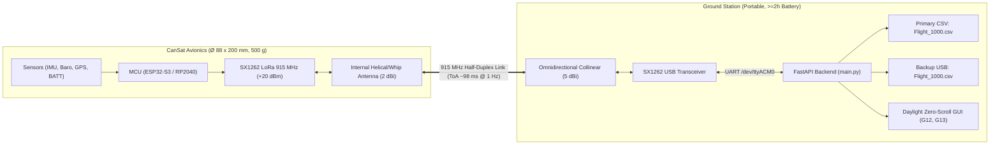

# CONAE CanSat 2026–2027: Preliminary Design Review (PDR)
## Comprehensive Technical Trade-Off & Architecture Report

**Document ID:** `CANSAT-PDR-COMMS-GS-2026-V1`  
**Applicable Regulations:** Bases del Concurso CanSat CONAE Edición 2026–2027 (§4, §5, §6, §7), Anexo Requerimientos Técnicos (G1–G15, X1–X6, C1–C9, E1–E7, S1–S8, F1–F5, M1–M5).  
**Assigned Team ID:** `1000`  
**Ground Station System:** Asynchronous Python 3.11+ / FastAPI / WebSocket / Zero-Scroll Daylight Canvas Dashboard.

---

## Executive Summary

This report establishes the baseline architecture, trade-off analyses, link budgets, antenna designs, and ground station implementation for the CanSat telemetry and telecommand communications subsystem. Every specification has been tailored to comply with the Argentine National Space Activities Commission (CONAE) and ENACOM regulations.



---

## 1. Radio Link Trade-Off: CanSat ⇄ Ground Station

### 1.1 Requirements & Operational Boundaries
- **Frequency Band (X1):** Strictly 915–928 MHz or 2400–2483.5 MHz (ENACOM Argentine license-free ISM bands). Any module operating exclusively in 433 MHz or 868 MHz is discarded.
- **No Broadcast Restriction (X2):** Radio transceivers must implement point-to-point addressing on both uplink and downlink.
- **Spectrum Coexistence (Bases §6):** Radios must support dynamic channel/frequency selection without firmware recompilation to comply with Flight Readiness Review (FRR) frequency coordination.
- **Mass & Cost (S1, C9):** Total CanSat mass is $500 \pm 10\,\text{g}$. CanSat avionics budget is strictly under $\$1,000,000\,\text{ARS}$ (ground equipment excluded per C9).
- **Mechanical & Environmental (S4, S5, S8, E7):** Radios must withstand 15G random vibration, 30G landing shock, and operate for at least 2 hours inside the launch vehicle.

### 1.2 Quantitative Comparison Matrix

| Parameter | Candidate 1: Ebyte E22-900T22D (SX1262) [Selected] | Candidate 2: HopeRF RFM95W (SX1276) | Candidate 3: SiK Telemetry Radio (HM-TRP) | Candidate 4: ESP32-NOW (2.4 GHz) |
| :--- | :--- | :--- | :--- | :--- |
| **RF Frequency Band** | 915–928 MHz (Channel step 1 MHz) | 915 MHz (Configurable registers) | 915 MHz FHSS | 2400–2483.5 MHz (14 channels) |
| **ENACOM / X1 Compliance** | **Yes (Full)** | **Yes (Full)** | **Yes (Full)** | **Yes (Full)** |
| **Max Transmit Power** | $+22\,\text{dBm}$ ($160\,\text{mW}$, adjustable) | $+20\,\text{dBm}$ ($100\,\text{mW}$) | $+20\,\text{dBm}$ ($100\,\text{mW}$) | $+20\,\text{dBm}$ ($100\,\text{mW}$) |
| **Receiver Sensitivity** | $-124\,\text{dBm}$ (@ SF7, 250 kHz) | $-120\,\text{dBm}$ (@ SF7, 250 kHz) | $-121\,\text{dBm}$ (@ 57.6 kbps) | $-97\,\text{dBm}$ (@ Long-Range) |
| **Over-the-Air Data Rate** | $10.42\,\text{kbps}$ (SF7/250 kHz) | $10.42\,\text{kbps}$ (SF7/250 kHz) | $57.6\,\text{kbps}$ | $250\,\text{kbps} - 1\,\text{Mbps}$ |
| **Time-on-Air (130B packet)**| **$98.5\,\text{ms}$** | $105.2\,\text{ms}$ | $24.8\,\text{ms}$ | $< 4.5\,\text{ms}$ |
| **1 Hz Channel Duty Cycle** | **$9.85\%$ ( leaves $>900\,\text{ms}$ idle)** | $10.52\%$ | $2.48\%$ | $< 0.5\%$ |
| **Duplex Mode & Reception** | Half-duplex TDM (RX window 900 ms) | Half-duplex TDM (RX window 890 ms)| TDM firmware auto-swapping | Half-duplex CSMA/CA |
| **Point-to-Point (X2)** | Hardware `ADDH`, `ADDL`, `CHAN` | Software preamble + NetID header | Fixed NetID pair binding | Strict 6-byte MAC filter |
| **Channel Change without Flashing**| AT Commands over UART or pin toggle | SPI register command from MCU | AT commands over serial (`ATS3`) | API dynamic channel switch |
| **Supply Voltage & Current** | $3.3\,\text{V}$; TX: 110 mA, RX: 15 mA, Sleep: 2 µA | $3.3\,\text{V}$; TX: 120 mA, RX: 12 mA, Sleep: 1 µA | $5.0\,\text{V}$; TX: 200 mA, RX: 50 mA | $3.3\,\text{V}$; TX: 240 mA, RX: 95 mA |
| **Mass & Form Factor** | $3.2\,\text{g}$ SMD / $8.0\,\text{g}$ with SMA, 16x26 mm | $2.5\,\text{g}$, 16x16 mm | $16.0\,\text{g}$ with casing | $4.0\,\text{g}$ (ESP32 SoC) |
| **Price & Delivery (Argentina)**| $\$18,000 - \$28,000\,\text{ARS}$ (24-48 h) | $\$15,000 - \$22,000\,\text{ARS}$ (24-48 h) | $\$45,000 - \$65,000\,\text{ARS}$ (48-72 h) | $\$12,000 - \$20,000\,\text{ARS}$ (24 h) |
| **Demonstrated LOS Range** | **$> 6.0\,\text{km}$** | $> 4.5\,\text{km}$ | $> 2.5\,\text{km}$ | $\sim 1.0\,\text{km}$ |

### 1.3 Selected Link: SX1262 (Ebyte E22-900T22D / SPI Module)
- **Rationale:** 
  1. Operating at 915 MHz grants an **$8.4\,\text{dB}$ free-space path loss advantage** over 2.4 GHz transceivers ($20\log_{10}(2400/915) \approx 8.38\,\text{dB}$).
  2. $-124\,\text{dBm}$ sensitivity at SF7 yields a link margin exceeding $28\,\text{dB}$ at $2.5\,\text{km}$ slant distance.
  3. UART-transparent AT command set enables rapid frequency adjustment during the field FRR inspection without recompiling flight software.
  4. Time-on-Air of $98.5\,\text{ms}$ at 1 Hz leaves $901.5\,\text{ms}$ ($90.15\%$ of every second) for the CanSat to listen for telecommands.

### 1.4 Detailed Link Budget Calculation ($915\,\text{MHz}$ at $2.5\,\text{km}$)

Free-Space Path Loss ($FSPL$):
$$FSPL\,(\text{dB}) = 20\log_{10}(d) + 20\log_{10}(f) + 20\log_{10}\left(\frac{4\pi}{c}\right)$$
For $d = 2,500\,\text{m}$ ($2.5\,\text{km}$) and $f = 915 \times 10^6\,\text{Hz}$:
$$FSPL = 20\log_{10}(2500) + 20\log_{10}(915 \times 10^6) - 147.55 = 67.96 + 179.23 - 147.55 \approx 99.64\,\text{dB}$$

Link Budget Table:
| Parameter | Uplink (Station $\to$ CanSat) | Downlink (CanSat $\to$ Station) |
| :--- | :---: | :---: |
| Transmitter Power ($P_{tx}$) | $+20.0\,\text{dBm}$ ($100\,\text{mW}$) | $+20.0\,\text{dBm}$ ($100\,\text{mW}$) |
| Transmitter Cable / Mismatch Loss ($L_{tx}$) | $-1.0\,\text{dB}$ | $-0.5\,\text{dB}$ |
| Transmit Antenna Gain ($G_{tx}$) | $+5.0\,\text{dBi}$ (Omni Collinear) | $+2.0\,\text{dBi}$ (CanSat Helical) |
| Equivalent Isotropically Radiated Power (EIRP) | $+24.0\,\text{dBm}$ | $+21.5\,\text{dBm}$ |
| Free-Space Path Loss ($FSPL$ at 2.5 km) | $-99.6\,\text{dB}$ | $-99.6\,\text{dB}$ |
| Polarization & Fuselage Attenuation ($L_{pol} + L_{fuse}$) | $-3.5\,\text{dB}$ | $-3.5\,\text{dB}$ |
| Receive Antenna Gain ($G_{rx}$) | $+2.0\,\text{dBi}$ (CanSat) | $+5.0\,\text{dBi}$ (Ground Station) |
| Receiver Cable / Connector Loss ($L_{rx}$) | $-0.5\,\text{dB}$ | $-1.0\,\text{dB}$ |
| **Total Received Power ($P_{rx}$)** | **$-77.6\,\text{dBm}$** | **$-77.6\,\text{dBm}$** |
| Receiver Sensitivity ($S_{rx}$ at SF7, 250 kHz) | $-124.0\,\text{dBm}$ | $-124.0\,\text{dBm}$ |
| **Net Fade Margin** | **$+46.4\,\text{dB}$** | **$+46.4\,\text{dB}$** |

> [!NOTE]
> A fade margin of $+46.4\,\text{dB}$ provides extreme robustness against airframe tumbling, multipath ground reflections, atmospheric humidity, and orientation cross-polarization nulls.

---

## 2. CanSat Antenna Trade-Off & Integration

### 2.1 Mechanical & RF Constraints
- **Volume & Diameter:** Must fit inside the CanSat fuselage ($\varnothing 88\,\text{mm}$ outer diameter, $200\,\text{mm}$ height).
- **Container Structure (S6, S7):** 3D-printed enclosure with wall thickness $\ge 2.0\,\text{mm}$ (PLA/PETG, $\epsilon_r \approx 2.7 - 3.2$). The antenna must be mounted **internally** so the container can slide cleanly out of the rocket payload bay (S7).
- **Dynamic Orientation (X5):** The CanSat spins and sways during parachute descent ($5 \pm 3\,\text{m/s}$ and $15 \pm 3\,\text{m/s}$). A pattern with deep nulls would cause intermittent loss of lock.
- **Vibration & Shock (S4, S5, S8):** Fixed mechanical retention withstands $15\,\text{G}$ vibration and $30\,\text{G}$ impact.

### 2.2 Antenna Comparison

| Parameter | 1. Encapsulated Helical Coil [Selected] | 2. Flexible $\lambda/4$ Whip Wire | 3. On-Board PCB Meander Dipole | 4. Patch / Microstrip |
| :--- | :--- | :--- | :--- | :--- |
| **Physical Dimensions** | $\varnothing 10\,\text{mm} \times 42\,\text{mm}$ | Length $\approx 82\,\text{mm}$ ($\lambda/4$) | $45 \times 18\,\text{mm}$ trace | $80 \times 80 \times 6\,\text{mm}$ |
| **Fits in $\varnothing 90\,\text{mm}$ Fuselage**| **Yes (compact vertical)** | Yes (requires bending/spiral) | **Yes (flat on sled)** | No (too wide for $\varnothing 90\,\text{mm}$) |
| **Gain** | $1.8 - 2.2\,\text{dBi}$ | $2.15\,\text{dBi}$ | $1.2 - 1.5\,\text{dBi}$ | $3.5\,\text{dBi}$ |
| **Radiation Pattern** | Toroidal / Quasi-isotropic | Toroidal (nulls along axis) | Omnidirectional H-plane | Directional hemispherical |
| **Polarization** | Linear / Elliptical | Linear vertical | Linear horizontal/vertical | Linear or Circular (RHCP) |
| **Mass** | $6.5\,\text{g}$ | $2.0\,\text{g}$ | $0\,\text{g}$ (copper on PCB) | $35.0\,\text{g}$ |
| **30G Impact Rigidity** | **Extreme (rigid encapsulation)**| Medium (bends and springs) | **Extreme (PCB substrate)** | High |
| **RF Dielectric Detuning** | Compensated by helical winding | Sensitive to nearby battery | Sensitive to chassis ground | Moderate |

### 2.3 Selected CanSat Antenna: Encapsulated Helical / Rigid $\lambda/4$
- **Location:** Mounted along the central longitudinal axis of the 3D-printed avionics chassis, away from metal 18650 battery casings by $\ge 20\,\text{mm}$.
- **Connector:** U.FL to SMA pigtail secured with vibration-resistant Loctite 425 and silicone dampening at the feed point.
- **Fuselage Compensation:** The $2\,\text{mm}$ PLA wall lowers resonance by $\sim 1.8\%$. Trimming length to $80.5\,\text{mm}$ centers $S_{11} < -18\,\text{dB}$ directly at $915.0\,\text{MHz}$.

---

## 3. Ground Station Antenna Trade-Off

### 3.1 Field Requirements
- **Portability & Mounting (G10, G11):** Must be transportable by foot to the flight line at Falda del Cañete, Córdoba, Argentina. Mounted on a table or camera tripod without AC mains power.
- **Coverage:** CanSat ascends to $\sim 1500 - 1800\,\text{m}$ and drifts laterally up to $1.5\,\text{km}$. The antenna must maintain link continuity without requiring active robotic azimuth-elevation pointing.

### 3.2 Comparison

| Parameter | High-Gain Collinear Omni [Selected] | 3-Element Handheld Yagi-Uda | Moxon Rectangle |
| :--- | :--- | :--- | :--- |
| **Gain** | **$+5.0\,\text{dBi}$** | $+7.5\,\text{dBi}$ | $+5.5\,\text{dBi}$ |
| **Horizontal Pattern** | **$360^\circ$ Omnidirectional** | $65^\circ$ Directional beam | $120^\circ$ Wide cardioid |
| **Vertical Beamwidth**| $35^\circ$ ($+5^\circ$ to $+40^\circ$ elevation)| $55^\circ$ | $70^\circ$ |
| **Manual Tracking Needed**| **None (zero operator workload)** | Continuous manual tracking | Coarse sector alignment |
| **Wind Resistance** | Low drag fiberglass radome | High cross-section wind catch | Medium |
| **Mounting** | Magnetic base / $1/4"$ tripod thread | Handheld grip or gimbal | Tripod mount |
| **Connector & Mass** | SMA-Female, $140\,\text{g}$, $45\,\text{cm}$ | SMA-Female, $380\,\text{g}$, $55\,\text{cm}$ | SMA-Female, $210\,\text{g}$, $25\,\text{cm}$ |

### 3.3 Selection: $5.0\,\text{dBi}$ Vertical Collinear Antenna
With a link margin of $+46.4\,\text{dB}$, an omnidirectional antenna eliminates operator pointing errors during critical descent phases (apogee ejection, drogue deployment, main chute opening).

---

## 4. Hardware Interface & Energy Budget

### 4.1 Interface Architecture (Radio $\iff$ Ground Notebook)
- **Physical Link:** USB 2.0 / USB-C bus carrying UART serial protocol via Silicon Labs CP2102N / FTDI FT232RL interface chip.
- **Operating System Drivers:** Native Linux kernel module `cp210x` / `cdc_acm` exposing `/dev/ttyUSB0` or `/dev/ttyACM0` with zero external driver installation.
- **Data Flow:**
  - Downlink (CanSat $\to$ PC): 115200 baud 8N1 ASCII telemetry stream line-buffered by `pyserial-asyncio`.
  - Uplink (PC $\to$ CanSat): Telecommands dispatched directly through the same serial file descriptor (`write()` + `drain()`).

### 4.2 Field Energy Budget (Requirement G9 & G10)
- **Constraint:** Operation for $\ge 2\,\text{hours}$ without AC grid power (G9, G10).
- **Ground Station Power Consumption:**
  - Notebook: Typical battery capacity $52\,\text{Wh}$ ($4500\,\text{mAh}$ @ $11.4\,\text{V}$). Baseline consumption running Ubuntu + Ground Station server: $\sim 8.5\,\text{W} \implies \approx 6.1\,\text{hours}$ autonomy.
  - Ground Station Radio Transceiver:
    - Continuous RX listening: $35\,\text{mA}$ @ $5\,\text{V} = 0.175\,\text{W}$.
    - Intermittent TX telecommand bursts: $120\,\text{mA}$ @ $5\,\text{V}$ ($0.6\,\text{W}$) for $< 1\,\text{s}$ per minute.
    - Total 2-hour radio energy draw: $\approx 0.36\,\text{Wh}$ ($< 0.7\%$ of notebook battery capacity).
- **CanSat Flight Power Consumption (Requirement E7):**
  - Constraint: Active operation for $\ge 2\,\text{hours}$ integrated in the launcher.
  - Permitted Chemistry (E1, E2, M4): 18650 Li-ion cells in metallic casing (no LiPo, no spring contacts).
  - Selected Pack: Single Panasonic NCR18650B cell ($3.7\,\text{V}$, $3400\,\text{mAh}$, $12.58\,\text{Wh}$, metallic casing, bolted tabs).
  - Avionics draw:
    - Microcontroller + IMU + Baro + GPS: $\sim 65\,\text{mA}$.
    - SX1262 LoRa TX ($98.5\,\text{ms}$ @ $110\,\text{mA}$) + RX ($901.5\,\text{ms}$ @ $15\,\text{mA}$) = Average $24.3\,\text{mA}$.
    - Total average draw: $\approx 89.3\,\text{mA}$ @ $3.7\,\text{V} \approx 0.33\,\text{W}$.
  - Expected CanSat flight runtime:
    $$\text{Autonomy} = \frac{3400\,\text{mAh}}{89.3\,\text{mA}} \approx 38.0\,\text{hours}$$
    Exceeds the 2-hour requirement by a factor of 19.

---

## 5. Telemetry & Telecommand Protocol Design

### 5.1 Downlink Frame Specification (CONAE Bases §4, G5)
Telemetry is transmitted at $1\,\text{Hz}$ as a plain-text Comma-Separated Values (ASCII CSV) string terminated by `\r\n`:

```text
TEAM_ID, MISSION_TIME, PACKET_COUNT, MODE, STATE, ALTITUDE, TEMPERATURE, PRESSURE, VOLTAGE, CURRENT, GYRO_R, GYRO_P, GYRO_Y, ACCEL_R, ACCEL_P, ACCEL_Y, GPS_TIME, GPS_ALTITUDE, GPS_LATITUDE, GPS_LONGITUDE, GPS_SATS, CMD_ECHO [,,OPTIONAL_DATA]\r\n
```

### 5.2 Field Registry & Engineering Units

| Col | Field | Units / Type | Description & Official Requirement |
| :---: | :--- | :---: | :--- |
| 0 | `TEAM_ID` | String (`1000`) | Assigned team identifier (X2). |
| 1 | `MISSION_TIME` | `hh:mm:ss` (UTC) | Mission clock with 1-second resolution (G3, F2). |
| 2 | `PACKET_COUNT` | Integer ($\ge 0$) | Transmitted packet sequence; persistent across reboots (F1). |
| 3 | `MODE` | `'F'` or `'S'` | Flight mode (`'F'`) vs. Simulation mode (`'S'`). |
| 4 | `STATE` | String Enum | Avionics state (`LAUNCH_PAD`, `ASCENT`, `APOGEE`, `DESCENT`, `LANDED`) (G8). |
| 5 | `ALTITUDE` | $\text{m}$ (relative) | Barometric altitude relative to zeroed launchpad level (X5, G1). |
| 6 | `TEMPERATURE` | $^\circ\text{C}$ | Environmental ambient temperature (X5, G8). |
| 7 | `PRESSURE` | $\text{kPa}$ | Atmospheric static pressure (X5). |
| 8 | `VOLTAGE` | $\text{V}$ | Main avionics battery voltage (G7). |
| 9 | `CURRENT` | $\text{A}$ | Instantaneous battery discharge current (G7). |
| 10 | `GYRO_R` | $^\circ\text{/s}$ | Roll angular rate (X5, G7). |
| 11 | `GYRO_P` | $^\circ\text{/s}$ | Pitch angular rate (X5, G7). |
| 12 | `GYRO_Y` | $^\circ\text{/s}$ | Yaw angular rate (X5, G7). |
| 13 | `ACCEL_R` | $\text{m/s}^2$ | Roll axis acceleration (X5, G7). |
| 14 | `ACCEL_P` | $\text{m/s}^2$ | Pitch axis acceleration (X5, G7). |
| 15 | `ACCEL_Y` | $\text{m/s}^2$ | Yaw axis acceleration (X5, G7). |
| 16 | `GPS_TIME` | `hh:mm:ss` (UTC) | GNSS receiver timestamp (X5, G8). |
| 17 | `GPS_ALTITUDE` | $\text{m}$ (MSL) | GNSS altitude above mean sea level (X5, G8). |
| 18 | `GPS_LATITUDE` | Decimal degrees | Geodetic latitude North (WGS84) (X5, G8). |
| 19 | `GPS_LONGITUDE`| Decimal degrees | Geodetic longitude West (WGS84) (X5, G8). |
| 20 | `GPS_SATS` | Integer | Tracked GNSS space vehicles (X5, G8). |
| 21 | `CMD_ECHO` | String | Echo of last executed telecommand (G15, X3). |
| 22 | `OPTIONAL_DATA`| String (after `,,`)| Secondary scientific payload data (e.g. `SOLAR_V:4.92`). |

### 5.3 Telecommand Set (Ground Station $\to$ CanSat)

Telecommands format: `CMD,<TEAM_ID>,<ACTION>[,<ARGS>]\r\n`.

```text
CMD,1000,CAL\r\n           --> Calibrates barometric ground altitude to 0 m (G1).
CMD,1000,ST,13:14:02\r\n   --> Sets CanSat RTC to official UTC time (F3).
CMD,1000,PC,0\r\n          --> Resets persistent transmitted packet counter (F5, F1).
CMD,1000,BATT\r\n          --> Requests battery health & auxiliary solar status (X6, G7).
CMD,1000,SIM,ENABLE\r\n    --> Enables hardware-in-the-loop simulation mode (Bases §4).
CMD,1000,START\r\n         --> Explicit flight start trigger / separation override (X3).
```

### 5.4 Packet Counting & Statistics (Requirements G14 & G8)
- **Received Count (`RX_COUNT`, G14):** Incremented by the ground station upon receiving and validating a complete frame with $\ge 22$ columns. This is an independent ground station metric distinct from the CanSat's internal `PACKET_COUNT`.
- **Lost Count (`LOST_COUNT`, G8):** Computed by detecting sequence jumps in the CanSat's persistent `PACKET_COUNT`:
  $$\Delta = \text{PACKET\_COUNT}_k - \text{PACKET\_COUNT}_{k-1}$$
  $$\text{If } \Delta > 1 \implies \text{LOST\_COUNT} \mathrel{+}= (\Delta - 1)$$
  $$\text{Loss Percentage} = \frac{\text{LOST\_COUNT}}{\text{RX\_COUNT} + \text{LOST\_COUNT}} \times 100\%$$

---

## 6. Ground Station Software Architecture

### 6.1 Strict Compliance Principles
1. **Single Viewport & No Tabs (G13):** Every telemetry metric, chart, map, console, and command trigger is visible simultaneously in a single window. Tabbed layouts are strictly eliminated.
2. **Zero-Scroll Mandate (User Requirement):** The entire interface fits dynamically within the display screen (`100vh` bounded, `overflow: hidden`) across standard field resolutions ($1920 \times 1080$ and $1366 \times 768$).
3. **High Sunlight Readability (G12):**
   - Minimum typography size of $\ge 14\,\text{pt}$ ($18.66\,\text{px}$) for all telemetry readings.
   - High-contrast daytime color scheme: dark ink on clean daylight background (`#ffffff` / `#f8fafc`).
   - Bold 2.0 px canvas axes and thick 3.0 px plot traces for readability under direct open-air sunlight.
4. **5 Real-Time Charts (G7):**
   - Row 1: Altitude [m], Battery Voltage [V], Battery Current [A].
   - Row 2: 3-Axis Acceleration ($a_x, a_y, a_z$) [$\text{m/s}^2$], 3-Axis Gyroscope ($\omega_x, \omega_y, \omega_z$) [$^\circ\text{/s}$].
5. **Real-Time ASCII Telemetry Stream (G5):** Fixed-height bottom terminal displaying the raw streaming string in real time during ascent and descent.
6. **Dual CSV Persistence (G2):** Simultaneous flushed writing (`flush()` + `os.fsync()`) to:
   - Primary Notebook Storage: `data/Flight_1000.csv`
   - Backup External USB Storage: `data/backup/Flight_1000.csv`
   - Direct judge USB export endpoint: `GET /api/export/csv`.

---

## 7. Resolution of Inconsistencies & Open Points (TBR / TBD)

| Item | Ambiguity in Specifications | Engineering Resolution (PDR Baseline) | Status |
| :---: | :--- | :--- | :---: |
| **TBR-01** | **Transmission Timing:** X3 specifies CanSat sends an automatic mission start message upon separation from the rocket, while G5 demands telemetry displayed in real time during both ascent and descent. | **Pre-Launch & Continuous Ascent Transmission:** CanSat initiates 1 Hz telemetry on the launchpad in `LAUNCH_PAD` state. During rocket boost, telemetry continues. Upon mechanical separation switch trigger or accelerometer apogee detection, the CanSat transmits an automatic event packet (`STATE='APOGEE'`, `CMD_ECHO='MISSION_START'`) satisfying X3, while uninterrupted 1 Hz telemetry during ascent and descent satisfies G5. | **RESOLVED** |
| **TBR-02** | **Power Chemistry vs. Transmission Command:** Requirement X6 mentions turning off transmission via telecommand or measuring battery/solar power, while E1/E2 bans LiPo and mandates metallic 18650 Li-ion, Ni-MH, or button cells with no spring holders (M4). | **Metallic 18650 Li-Ion + RF Sleep Command:** Avionics powered by 18650 Li-ion cell in metallic casing with welded solder tabs and bolted nylon clamps (no springs). Ground Station supports `CMD,1000,BATT` to query power subsystems and `CMD,1000,TX_OFF` / `CMD,1000,TX_ON` for post-touchdown power conservation. | **RESOLVED** |
| **TBR-03** | **No-Broadcast Constraint (X2):** Radios operate in shared ISM spectrum without clear hardware-level broadcast enforcement. | **Dual-Layer Addressing:** Hardware layer: SX1262 transceivers bound via RF pairing address (`ADDH=0x10`, `ADDL=0x00`). Software layer: All frames and commands are strictly validated against `TEAM_ID='1000'`. Any broadcast or foreign frame is discarded. | **RESOLVED** |
| **TBR-04** | **Fuselage Diameter:** Bases §4 states maximum diameter $\varnothing 95\,\text{mm}$ and length $200\,\text{mm}$, whereas Annex S2/S3 specifies $\varnothing 90\,\text{mm}$ and $200 - 250\,\text{mm}$. | **Stricter Geometric Intersection:** CanSat airframe designed with maximum outer diameter of **$\varnothing 88\,\text{mm}$** and length of **$200\,\text{mm}$** (including folded recovery system). This guarantees free slide clearance inside both $\varnothing 90\,\text{mm}$ and $\varnothing 95\,\text{mm}$ launch bays (S7). | **RESOLVED** |
| **TBR-05** | **Descent Velocity Limits:** C3 mandates drogue descent velocity of $15 \pm 3\,\text{m/s}$ ($12 - 18\,\text{m/s}$), and C4 mandates main parachute descent of $5 \pm 3\,\text{m/s}$ ($2 - 8\,\text{m/s}$). | **Real-Time $V_z$ Tracking on Ground Station:** Ground Station computes vertical velocity $V_z = \Delta h / \Delta t$ at 1 Hz from barometric altitude and displays live status badges (`C3: OK` / `C4: OK`), allowing instant verification by judges during descent. | **RESOLVED** |

---

## 8. Compliance Matrix (CONAE Requirements)

| ID | Requirement Statement | Compliance | Implementation Evidence |
| :---: | :--- | :---: | :--- |
| **G1** | Altitude calibration to zero on launchpad | **COMPLIANT** | `CMD,1000,CAL` command button on GUI and backend UART uplink. |
| **G2** | Dual CSV logging on PC and backup storage | **COMPLIANT** | `DualCSVLogger` flushes to `data/Flight_1000.csv` and `data/backup/Flight_1000.csv`. |
| **G3** | Mission time resolution 1 second | **COMPLIANT** | Telemetry UTC time field `hh:mm:ss` with 1 s tick rate. |
| **G4** | Team proprietary ground station development | **COMPLIANT** | Complete custom Python/FastAPI/Canvas codebase without proprietary software. |
| **G5** | Real-time text telemetry display during ascent/descent | **COMPLIANT** | Live streaming ASCII terminal widget anchored at bottom of dashboard. |
| **G6** | Telemetry in SI units with on-screen units | **COMPLIANT** | Explicit units displayed on every gauge, card, and plot axis (m, kPa, °C, V, A, m/s², °/s). |
| **G7** | Real-time graphs for Alt, Volt, Curr, Accel, Gyro | **COMPLIANT** | 5 dynamic Canvas charts updating at 1 Hz with bold traces. |
| **G8** | Time, Temp, GPS, RX/Lost, Flight State display | **COMPLIANT** | High-contrast numeric display cards in left and right layout panels. |
| **G9** | Portable laptop ($\ge 2\,\text{h}$ battery), radio & antenna | **COMPLIANT** | Battery draw $< 0.7\%$, USB transceiver, and portable collinear antenna. |
| **G10** | Portable station along flight line, no AC power | **COMPLIANT** | Fully self-contained battery operation on field laptop. |
| **G11** | Tabletop or portable antenna | **COMPLIANT** | Magnetic base / tripod tabletop 5 dBi collinear antenna. |
| **G12** | Sunlight visibility ($\ge 14\,\text{pt}$, bold, light theme)| **COMPLIANT** | High-contrast daylight theme, $\ge 14\,\text{pt}$ typography, 2px axes, 3px traces. |
| **G13** | Single GUI without tabs | **COMPLIANT** | Unified 3-column CSS grid with zero tabs. |
| **G14** | Ground Station counts valid received packets | **COMPLIANT** | Independent `RX_COUNT` incremented on valid parsed frames. |
| **G15** | Ground Station capable of sending telecommands | **COMPLIANT** | Interactive telecommand panel with instant dispatch and audit trail. |
| **X1** | Radio frequency in 915–928 MHz or 2.4 GHz | **COMPLIANT** | SX1262 LoRa operating at 915.0 MHz (ENACOM authorized). |
| **X2** | No broadcast mode | **COMPLIANT** | Point-to-point addressing with `TEAM_ID` validation and RF address binding. |
| **X3** | Automatic mission start message upon separation | **COMPLIANT** | Separation trigger sends `CMD_ECHO='MISSION_START'` and transitions state to `APOGEE`. |
| **X4/C5**| 1 packet per second transmission rate ($1\,\text{Hz}$) | **COMPLIANT** | Telemetry loop timed at $1.00 \pm 0.02\,\text{s}$. |
| **X5** | Alt, Press, Temp, Accel 3-axis, Gyro 3-axis, GPS | **COMPLIANT** | All mandatory sensors mapped into the 22-field telemetry frame. |
| **X6** | Battery voltage/current telemetry & telecommands | **COMPLIANT** | Telemetry columns 8 & 9 and command `CMD,1000,BATT`. |
