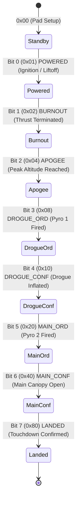

# Frame Specification & Binary Protocol Reference

This document provides the authoritative technical reference for the 30-byte telemetry binary frame transmitted by the rocket avionics and parsed by the Ground Station (`estacion-terrena-pc`).

---

## 1. Protocol Overview

The telemetry link uses a fixed-length, big-endian binary frame designed for robust transmission over low-bandwidth RF serial modems (e.g., LoRa, SiK, or XBee).

| Parameter | Specification | Reference in `config/frame.yaml` |
|---|---|---|
| **Frame Name** | Trama de Alta Frecuencia | `name: "Trama"` |
| **Protocol ID** | `0x01` | `id: 1` |
| **Total Frame Length** | 30 bytes | `frame.length: 30` |
| **Byte Ordering** | Big-Endian (Network Byte Order, MSB first) | `frame.byte_order: "big_endian"` |
| **Integrity Check** | CRC-16/CCITT-FALSE | `frame.crc.algorithm: "CRC-16/CCITT-FALSE"` |
| **CRC Location** | Bytes 28–29 (2 bytes) | `frame.crc.offset: 28`, `frame.crc.length: 2` |
| **CRC Calculation Range** | Bytes 0–27 inclusive (28 bytes) | `calculate_from: 0`, `calculate_to: 27` |
| **Transmission Rate** | 10 Hz nominal (configurable) | UART 115200 baud |
| **Raw Throughput** | 300 bytes/s (2,400 bps) | Requires RF modem Air Rate $\ge 9,600\text{ bps}$ |


---

## 2. 30-Byte Frame Memory Map

```text
Byte:   0    1    2    3    4    5    6    7    8    9   10   11   12   13   14
     ┌────┬────┬────┬────┬────┬────┬────┬────┬────┬────┬────┬────┬────┬────┬────┐
     │ ID │TYPE│  SEQ_NUM │    TIMESTAMP      │  ACC_X  │  ACC_Y  │  ACC_Z  │PRSS│
     └────┴────┴────┴────┴────┴────┴────┴────┴────┴────┴────┴────┴────┴────┴────┘
     
Byte:  15   16   17   18   19   20   21   22   23   24   25   26   27   28   29
     ┌────┬────┬────┬────┬────┬────┬────┬────┬────┬────┬────┬────┬────┬────┬────┐
     │  PRESSURE │      LATITUDE      │     LONGITUDE     │   ALT   │STAT│ CRC16 │
     └────┴────┴────┴────┴────┴────┴────┴────┴────┴────┴────┴────┴────┴────┴────┘
```

---

## 3. Field Specification Reference

The table below reflects the exact schema configuration defined in `config/frame.yaml`.

| Offset | Length | Field Name | Binary Type | Endian | Scale Factor | Physical Offset | Engineering Unit | Raw Range | Physical / Value Range | Description |
|:---:|:---:|---|:---:|:---:|:---:|:---:|:---:|---|---|---|
| **0** | 1 | `rocket_id` | `uint8` | — | `1.0` | `0` | — | `0` to `255` | `0` to `255` | Unique identifier of the rocket airframe |
| **1** | 1 | `frame_type` | `uint8` | — | `1.0` | `0` | — | Expected: `0x01` | Fixed constant `0x01` | Frame type identifier; used to reject foreign packets |
| **2** | 2 | `frame_number` | `uint16` | Big | `1.0` | `0` | — | `0` to `65,535` | `0` to `65,535` | Rolling sequential counter used for packet loss tracking |
| **4** | 4 | `timestamp` | `uint32` | Big | `1.0` | `0` | `ms` | `0` to `4,294,967,295` | `0` to $4.29 \times 10^6$ s (~49.7 d) | Mission elapsed time / avionics boot time in milliseconds |
| **8** | 2 | `accel_x` | `int16` | Big | `0.001` | `0` | `g` | `-32,768` to `+32,767` | `-32.768` to `+32.767 g` | Transverse body X-axis acceleration ($1\text{ mg}$ resolution) |
| **10** | 2 | `accel_y` | `int16` | Big | `0.001` | `0` | `g` | `-32,768` to `+32,767` | `-32.768` to `+32.767 g` | Transverse body Y-axis acceleration ($1\text{ mg}$ resolution) |
| **12** | 2 | `accel_z` | `int16` | Big | `0.0005` | `0` | `g` | `-32,768` to `+32,767` | `-16.384` to `+16.3835 g` | Longitudinal thrust Z-axis acceleration ($0.5\text{ mg}$ resolution) |
| **14** | 3 | `pressure` | `uint24` | Big | `1.0` | `0` | `Pa` | `0` to `16,777,215` | `0` to $167,772\text{ hPa}$ | Barometric atmospheric pressure in Pascals |
| **17** | 4 | `latitude` | `int32` | Big | `0.000001` | `0` | `deg` | `±90,000,000` | `-90.000000°` to `+90.000000°` | GNSS latitude ($10^{-6}$ degree / ~0.11 m resolution) |
| **21** | 4 | `longitude` | `int32` | Big | `0.000001` | `0` | `deg` | `±180,000,000` | `-180.000000°` to `+180.000000°` | GNSS longitude ($10^{-6}$ degree resolution) |
| **25** | 2 | `altitude` | `int16` | Big | `1.0` | `0` | `m` | `-32,768` to `+32,767` | `-32,768` to `+32,767 m` | GNSS/Barometric geometric altitude above reference |
| **27** | 1 | `status` | `uint8` | — | `1.0` | `0` | — | `0x00` to `0x05` | Discrete flight phases | Current vehicle state machine flight code |
| **28** | 2 | `crc` | `uint16` | Big | — | — | — | `0x0000` to `0xFFFF` | Checksum value | CRC-16/CCITT-FALSE calculated across bytes 0 to 27 |

---

## 4. Field Engineering Details

### 4.1 Header (`rocket_id`, `frame_type`)
- `rocket_id` (Byte 0): Identifies the rocket or vehicle instance in multi-vehicle flight campaigns.
- `frame_type` (Byte 1): Must equal `0x01`. The ground station parser automatically rejects any packet if the received byte does not match `expected_value: 0x01`.

### 4.2 Sequence Counter & Timing (`frame_number`, `timestamp`)
- `frame_number` (Bytes 2–3): An unsigned 16-bit integer incremented with each emitted telemetry frame. The ground station detects packet loss when `received_seq > (last_seq + 1)`. When the counter rolls over from `65535` to `0`, modular arithmetic is used to avoid false loss detection.
- `timestamp` (Bytes 4–7): Unsigned 32-bit millisecond counter. At 10 Hz, this counter will not overflow for over 49 days of continuous uptime.

### 4.3 Accelerometer Channels (`accel_x`, `accel_y`, `accel_z`)
- All axes use two's-complement signed 16-bit representations.
- `accel_x` and `accel_y` use a scale of `0.001` ($1\text{ LSB} = 1\text{ mg}$), providing a span of $\pm 32.768\text{ g}$.
- `accel_z` corresponds to the primary longitudinal vehicle axis (thrust line). It uses a finer scale of `0.0005` ($1\text{ LSB} = 0.5\text{ mg}$), offering higher sensitivity with a measurement range of $\pm 16.384\text{ g}$.

### 4.4 Barometric Pressure (`pressure`)
- Encoded as an unsigned 24-bit big-endian integer (`uint24`) occupying 3 bytes (Bytes 14, 15, and 16).
- Unpacked directly as:
  $$\text{pressure} = (\text{Byte}_{14} \ll 16) \mid (\text{Byte}_{15} \ll 8) \mid \text{Byte}_{16}$$
- Unit is Pascals ($1\text{ Pa} = 0.01\text{ hPa} = 0.01\text{ mbar}$). Sea-level standard pressure ($101,325\text{ Pa}$) is represented as raw value `101325` (`0x018BCD`).

### 4.5 Geolocation Coordinates (`latitude`, `longitude`, `altitude`)
- `latitude` and `longitude` are signed 32-bit integers scaled by $10^{-6}$ (`0.000001`), corresponding to standard micro-degree GPS encoding.
  - Latitude Example: $-34.603722^\circ$ is represented as raw integer `-34603722` (`0xFDEFFD36`).
  - Longitude Example: $-58.381592^\circ$ is represented as raw integer `-58381592` (`0xFC852AE8`).
- `altitude` is a signed 16-bit integer representing meters above ground/sea level.

---

## 5. Flight State Machine & Event Bitmask Definitions

The `status` field (Byte 27) tracks the operational phase and pyrotechnic deployment events of the rocket's flight computer via an 8-bit event bitmask.



### Event Bitmask Table

| Bit Index | Value (Hex) | Value (Dec) | Constant Name | Description |
|:---:|:---:|:---:|---|---|
| **Bit 0** | `0x01` | 1 | `POWERED` | Motor encendido / Despegue detectado (Ignition & liftoff) |
| **Bit 1** | `0x02` | 2 | `BURNOUT` | Fin de empuje del motor (Thrust burnout) |
| **Bit 2** | `0x04` | 4 | `APOGEE` | Apogeo alcanzado / Altura máxima (Peak altitude) |
| **Bit 3** | `0x08` | 8 | `DROGUE_ORD` | Orden enviada: Disparo de Pirotécnico 1 (Drogue parachute command) |
| **Bit 4** | `0x10` | 16 | `DROGUE_CONF` | Confirmado: Pirotécnico 1 efectivamente se activó (Drogue fire confirmed) |
| **Bit 5** | `0x20` | 32 | `MAIN_ORD` | Orden enviada: Disparo de Pirotécnico 2 (Main parachute command) |
| **Bit 6** | `0x40` | 64 | `MAIN_CONF` | Confirmado: Pirotécnico 2 efectivamente se activó (Main fire confirmed) |
| **Bit 7** | `0x80` | 128 | `LANDED` | Aterrizaje confirmado en tierra (Touchdown confirmed) |

---

## 6. CRC-16/CCITT-FALSE Specification

The integrity of every telemetry packet is verified using **CRC-16/CCITT-FALSE**.

### 6.1 Algorithmic Parameters

| Property | Value | Description |
|---|---|---|
| **Standard Name** | `CRC-16/CCITT-FALSE` | Also known as `CRC-16/AUTOSAR`, `CRC-16/IBM-3740` |
| **Polynomial** | `0x1021` | $x^{16} + x^{12} + x^5 + 1$ |
| **Initial Value (`initial_value`)** | `0xFFFF` | Register initialized to all ones |
| **Final XOR (`final_xor`)** | `0x0000` | No post-calculation inversion |
| **Reflect Input (`reflect_input`)** | `false` | Bits processed MSB-first |
| **Reflect Output (`reflect_output`)** | `false` | CRC output not reversed |
| **Standard Check Value** | `0x29B1` | Standard test vector for ASCII string `"123456789"` (`0x31..0x39`) |
| **Calculation Range** | Bytes `0` to `27` | Total 28 bytes (Byte 0 up to Byte 27 inclusive) |
| **Checksum Storage** | Bytes `28` and `29` | Transmitted in Big-Endian order: `[CRC_MSB, CRC_LSB]` |

### 6.2 Python Reference Implementation

The ground station validates the frame using the bitwise implementation below (`main.py`):

```python
def crc16_ccitt_false(data: bytes, polynomial: int = 0x1021, initial_value: int = 0xFFFF) -> int:
    """Calculate CRC-16/CCITT-FALSE over a sequence of bytes."""
    crc = initial_value
    for byte in data:
        crc ^= (byte << 8)
        for _ in range(8):
            if crc & 0x8000:
                crc = ((crc << 1) ^ polynomial) & 0xFFFF
            else:
                crc = (crc << 1) & 0xFFFF
    return crc

# Frame validation check
def is_frame_valid(frame_bytes: bytes) -> bool:
    if len(frame_bytes) != 30:
        return False
    payload = frame_bytes[0:28]          # Bytes 0 to 27 inclusive
    expected_crc = int.from_bytes(frame_bytes[28:30], byteorder="big")
    calculated_crc = crc16_ccitt_false(payload)
    return calculated_crc == expected_crc
```

### 6.3 Embedded C / C++ Reference Implementation

For flight computers (STM32, ESP32, Teensy, AVR):

```c
#include <stdint.h>
#include <stddef.h>

/**
 * @brief Computes CRC-16/CCITT-FALSE over a byte buffer.
 * @param data Pointer to byte buffer (bytes 0 to 27)
 * @param length Length of buffer (28 bytes)
 * @return uint16_t Computed CRC
 */
uint16_t crc16_ccitt_false(const uint8_t *data, size_t length) {
    uint16_t crc = 0xFFFF; // Initial value
    for (size_t i = 0; i < length; i++) {
        crc ^= ((uint16_t)data[i] << 8);
        for (uint8_t bit = 0; bit < 8; bit++) {
            if (crc & 0x8000) {
                crc = (crc << 1) ^ 0x1021; // Polynomial
            } else {
                crc = (crc << 1);
            }
        }
    }
    return crc;
}

/**
 * @brief Serializes and attaches CRC to the 30-byte frame buffer.
 * @param frame Array of at least 30 bytes.
 */
void finalize_frame(uint8_t *frame) {
    uint16_t crc = crc16_ccitt_false(frame, 28);
    frame[28] = (uint8_t)((crc >> 8) & 0xFF); // CRC MSB
    frame[29] = (uint8_t)(crc & 0xFF);        // CRC LSB
}
```

---

## 7. Concrete Verification Test Frame

Use the following hex vector to verify encoder and parser implementations:

### Test Frame Vector (Hexadecimal)
```text
01 01 00 0A 00 00 27 10 00 64 FF 9C 1F 40 01 8B CD FD EF FD 36 FC 85 2A E8 00 FA 02 3A F5
```

### Decoded Interpretation:
- `rocket_id`: `0x01` ($1$)
- `frame_type`: `0x01` ($1$)
- `frame_number`: `0x000A` ($10$)
- `timestamp`: `0x00002710` ($10,000\text{ ms} = 10.0\text{ s}$)
- `accel_x`: `0x0064` ($+100 \times 0.001 = +0.100\text{ g}$)
- `accel_y`: `0xFF9C` ($-100 \times 0.001 = -0.100\text{ g}$)
- `accel_z`: `0x1F40` ($+8,000 \times 0.0005 = +4.000\text{ g}$)
- `pressure`: `0x018BCD` ($101,325\text{ Pa} = 1013.25\text{ hPa}$)
- `latitude`: `0xFDEFFD36` ($-34,603,722 \times 10^{-6} = -34.603722^\circ$)
- `longitude`: `0xFC852AE8` ($-58,381,592 \times 10^{-6} = -58.381592^\circ$)
- `altitude`: `0x00FA` ($+250\text{ m}$)
- `status`: `0x02` (`Motor encendido / Ascenso`)
- `crc`: `0x3AF5` (CRC-16/CCITT-FALSE calculated across bytes 0..27)

---

## 8. Related Documentation

- **[System Architecture & Component Documentation](architecture.md):** Data pipeline, concurrency model, and real-time dashboard structure.
- **[API & WebSocket Interface Specification](api.md):** REST and WebSocket protocol endpoints, payload schemas, and client behavior.
- **[Getting Started & Operations Guide](getting-started.md):** Environment setup, serial permissions, and verification testing.
- **[Extended Calculations & Future Reference](calculos-futuros.md):** Advanced attitude, filtering, and impact calculations.
